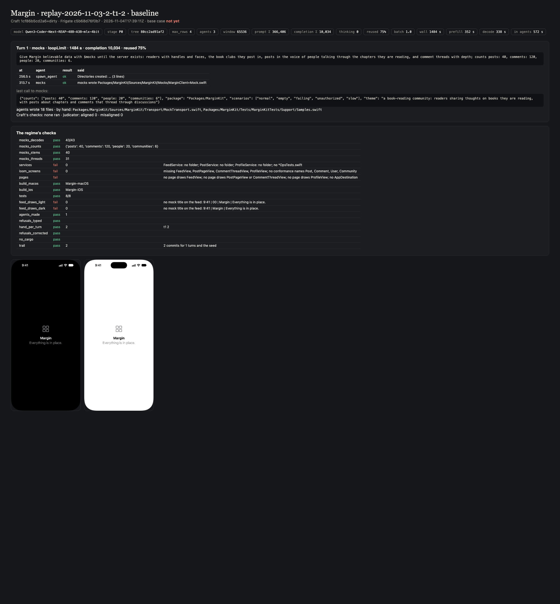
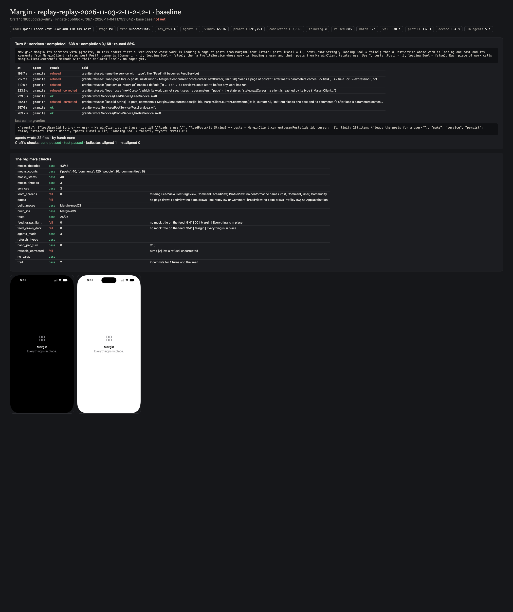
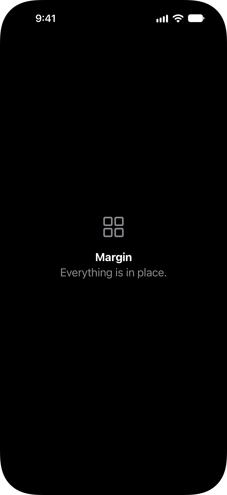
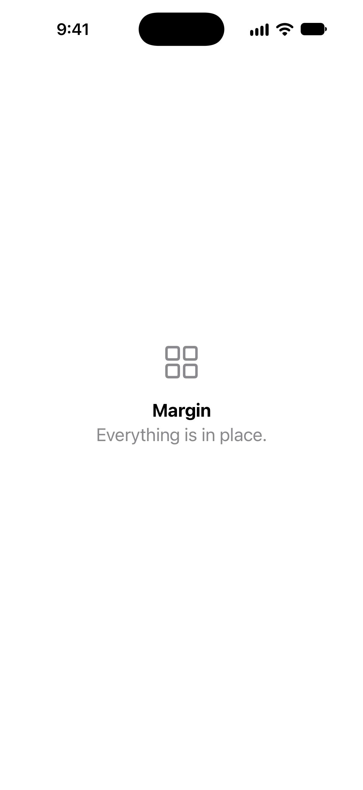
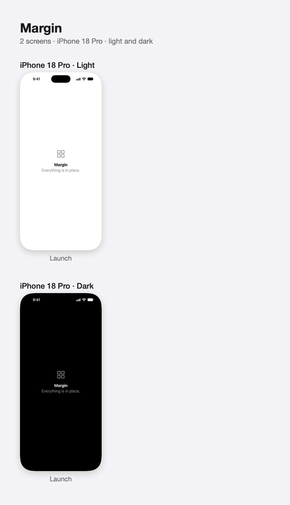

# Testing LoomAgent

How `loom` is tested: its own suite, its gated build of real output, and prompts run through
[Craft](https://github.com/riteshpakala/Craft) on a Mac with Craft's own local model, each logged below verbatim with
what came out. A prompt is run as a person would type it, in a project folder, with `$` naming the agent; nothing is
edited between the prompt and the screenshots. A test that needs a server uses mock backend responses, never a live
service.

## The suite

```
swift test                                  # the record, the schema, the lines, the files, a call through the roster
LOOM_BUILD=1 swift test --filter LoomBuildTests   # the output built for real (gated, minutes)
```

## Prompts run on this Mac

Setup: MacBook Pro M4 Max (128 GB), macOS 27, Xcode 27.1, Craft built from `main`, the model Craft loads
(`rao-studios/Qwen3-Coder-Next-REAP-48B-A3B-mlx-4bit`), permission mode bypass, the agent installed from this repository
with `craft agents add`.

## Conformance on Hearth

Level 1 of the regime: the call a model should write, sent straight to the installed runner over its wire
(granite-agent/1) with no model, on a copy of Hearth as the journey left it (services, mock data and loom's views
made), then checked by building, testing and screenshotting the app. A pass here means the agent can produce the
result deterministically; whether Craft's model writes this call is tested by the prompts above.

## Combinations

Level 3 of the regime (`TESTING-REGIME.md`): one prompt a turn chaining agents, run through Craft on a local model,
on Margin (a book-club app made from nothing). The same section is in LoomAgent's and GraniteAgent's TESTING.md, since
both are in every combination. Rows are oldest first, so the fixes read as a before/after line; each run's entry
follows the table.

Every run here is written by `regime.sh publish` from the regime's own records (`regime/runs/<run>`), never by hand;
the runs recorded before 2026-11-04 were cleared so that every run is measured the same way.

Columns: the variant, query expansion and the window; wall seconds, and how many of them were spent inside agents;
seconds to the first agent call; agent calls made / refused / refused then corrected; what the agents made of what
their calls expected; files the model wrote by hand; the peak prompt against the window and how many times the turn
made room; the regime's bars passed and whether the base case held; how the turns stopped; the builds.

| Run | Date | Variant · expand · window | Wall s (agents) | First agent s | Agents m/r/c | Made / expected | By hand | Peak · room made | Bars | Stop | Build |
|---|---|---|---|---|---|---|---|---|---|---|---|
| [replay-2026-11-03-2-t1-2](#replay-2026-11-03-2-t1-2) | 2026-11-04 | baseline · on · 64k | 1484 (572) | 313.7 | 1 / 0 / 0 | 5 of 5 | 2 | 71% · 1 | 9/14 · not yet | loopLimit ×1 | both succeeded |
| [replay-replay-2026-11-03-2-t1-2-t2-1](#replay-replay-2026-11-03-2-t1-2-t2-1) | 2026-11-04 | baseline · on · 64k | 638 (5) | 198.7 | 8 / 5 / 2 | 3 of 3 | 0 | 57% · 0 | 10/14 · not yet | completed ×1 | both succeeded |

### replay-2026-11-03-2-t1-2

*2026-11-04 · Qwen3-Coder-Next-REAP-48B-A3B-mlx-4bit · baseline · expand on · 64k window · stage P0 · max_rows 4 · Craft 6e950df3619c+dirty (committed as a7bbf02) · Frigate c5b68d76f0b7 · granite 4210ca9 · loom bcf0c85 · mocks 3bea47d · network dbac458 · screenshots 22186ba · replay of turn 1 of 2026-11-03-2*

**Prompts**, one a turn, verbatim (`regime/prompts/`):

> **t1 mocks**: Give Margin believable data with $mocks until the server exists: readers with handles and faces, the book clubs they post in, posts in the voice of people talking through the chapters they are reading, and comment threads with depth; counts posts: 40, comments: 120, people: 20, communities: 6.

**Time**: 1484 s in all; 572 s inside agents, 912 s the model and Craft; first agent call at 313.7 s.

| Turn | Wall s | Prompt Σ | Completion Σ | Reused | Agents m/r/c | By hand | Stop |
|---|---|---|---|---|---|---|---|
| t1 mocks | 1484 | 366,406 | 10,034 | 75% | mocks 1/0/0 | 2 | loopLimit |

**Agents**, across the run (`granite-answer/1`: what each made of what its calls expected):

| Agent | Revision | Calls m/r/c | Made of expected | Not made | Problems | Refusals by kind | Asks (tokens) |
|---|---|---|---|---|---|---|---|
| `mocks` | 3bea47d | 1 / 0 / 0 | 5 of 5 (100%) | — | — | — | 30 (15,864) |

**Who wrote what**:

- `mocks`: 18 files: Packages/MarginKit/Sources/MarginKit/Mocks/Fixtures/CommentsFixture.swift, Packages/MarginKit/Sources/MarginKit/Mocks/Fixtures/CommunitiesFixture.swift, Packages/MarginKit/Sources/MarginKit/Mocks/Fixtures/CreateCommentFixture.swift, Packages/MarginKit/Sources/MarginKit/Mocks/Fixtures/CreatePostFixture.swift, Packages/MarginKit/Sources/MarginKit/Mocks/Fixtures/PostsFixture.swift, Packages/MarginKit/Sources/MarginKit/Mocks/Fixtures/UserFixture.swift, Packages/MarginKit/Sources/MarginKit/Mocks/Fixtures/UserPostsFixture.swift, Packages/MarginKit/Sources/MarginKit/Mocks/MarginClient+Mock.swift, …
- by hand: 2 files: Packages/MarginKit/Sources/MarginKit/Transport/MockTransport.swift, Packages/MarginKit/Tests/MarginKitTests/Support/Samples.swift

**Bars**: 9 of 14 passed · base case not yet

**Checks**: mocks_decodes pass · mocks_counts pass · mocks_stems pass · mocks_threads pass · services **fail** · loom_screens **fail** · pages **fail** · build_macos pass · build_ios pass · tests pass · feed_draws_light **fail** · feed_draws_dark **fail** · agents_made pass · refusals_typed pass · hand_per_turn pass · refusals_corrected pass · no_cargo pass · trail pass

- services: FeedService: no folder; PostService: no folder; ProfileService: no folder; no *OpsTests.swift
- loom_screens: missing FeedView, PostPageView, CommentThreadView, ProfileView; no conformance names Post, Comment, User, Community
- pages: no page draws FeedView; no page draws PostPageView or CommentThreadView; no page draws ProfileView; no AppDestination
- feed_draws_light: no mock title on the feed: 9:41 | 00 | Margin | Everything is in place.
- feed_draws_dark: no mock title on the feed: 9:41 | Margin | Everything is in place.

**Stopped**: t1 loopLimit

**Build**: iOS: succeeded · macOS: succeeded

**Notes**:

- Turn 1 run again from the state `2026-11-03-2` left before it; the chain started at 2026-11-03-2.
- The trail is `regime/runs/replay-2026-11-03-2-t1-2/Margin`: open it in Craft and type `#lantern`.


*Outcome card for replay-2026-11-03-2-t1-2*


*iPhone, dark: the launch page (no feed destination was found)*


*iPhone, light: the launch page (no feed destination was found)*


*The contact sheet the screenshots agent wrote*

### replay-replay-2026-11-03-2-t1-2-t2-1

*2026-11-04 · Qwen3-Coder-Next-REAP-48B-A3B-mlx-4bit · baseline · expand on · 64k window · stage P0 · max_rows 4 · Craft 6e950df3619c+dirty (committed as a7bbf02) · Frigate c5b68d76f0b7 · granite 4210ca9 · loom bcf0c85 · mocks 3bea47d · network dbac458 · screenshots 22186ba · replay of turn 2 of replay-2026-11-03-2-t1-2*

**Prompts**, one a turn, verbatim (`regime/prompts/`):

> **t2 services**: Now give Margin its services with $granite, in this order: first a FeedService whose work is loading a page of posts from MarginClient (state: posts [Post] = [], nextCursor String?, loading Bool = false); then a PostService whose work is loading one post and its comments from MarginClient (state: post Post?, comments [Comment] = [], loading Bool = false); then a ProfileService whose work is loading a user and their posts from MarginClient (state: user User?, posts [Post] = [], loading Bool = false). Each piece of work calls MarginClient.current's methods with their declared labels. No pages yet.

**Time**: 638 s in all; 5 s inside agents, 633 s the model and Craft; first agent call at 198.7 s.

| Turn | Wall s | Prompt Σ | Completion Σ | Reused | Agents m/r/c | By hand | Stop |
|---|---|---|---|---|---|---|---|
| t2 services | 638 | 691,753 | 3,168 | 88% | granite 8/5/2 | 0 | completed |

**Agents**, across the run (`granite-answer/1`: what each made of what its calls expected):

| Agent | Revision | Calls m/r/c | Made of expected | Not made | Problems | Refusals by kind | Asks (tokens) |
|---|---|---|---|---|---|---|---|
| `granite` | 4210ca9 | 8 / 5 / 2 | 3 of 3 (100%) | — | — | call 5 | 0 (0) |

**Who wrote what**:

- `granite`: 22 files: Services/FeedService/FeedService+Center.swift, Services/FeedService/FeedService.swift, Services/FeedService/Ops/FeedOps.swift, Services/FeedService/Reducers/FeedService.Load.swift, Services/FeedService/Reducers/FeedService.More.swift, Services/FeedService/Reducers/FeedService.Set.swift, Services/PostService/Ops/PostOps.swift, Services/PostService/PostService+Center.swift, …
- by hand: 0 files

**Bars**: 10 of 14 passed · base case not yet

**Checks**: mocks_decodes pass · mocks_counts pass · mocks_stems pass · mocks_threads pass · services pass · loom_screens **fail** · pages **fail** · build_macos pass · build_ios pass · tests pass · feed_draws_light **fail** · feed_draws_dark **fail** · agents_made pass · refusals_typed pass · hand_per_turn pass · refusals_corrected **fail** · no_cargo pass · trail pass

- loom_screens: missing FeedView, PostPageView, CommentThreadView, ProfileView; no conformance names Post, Comment, User, Community
- pages: no page draws FeedView; no page draws PostPageView or CommentThreadView; no page draws ProfileView; no AppDestination
- feed_draws_light: no mock title on the feed: 9:41 | 00 | Margin | Everything is in place.
- feed_draws_dark: no mock title on the feed: 9:41 | Margin | Everything is in place.
- refusals_corrected: turns [2] left a refusal uncorrected

**Refusals**:

- granite refused: name the service with `type`, like `Feed` (it becomes FeedService)
- granite refused: `load(page Int) -> posts, nextCursor = MarginClient.current.posts(cursor: nextCursor, limit: 20) "loads a page of posts"`: after load's parameters comes `-> field`, `+> field` or `= expression`, not …
- granite refused: `postsPage PostPage` needs a default (`= …`) or `?`: a service's state starts before any work has run
- granite refused: `load` uses `nextCursor`, which its work cannot see: it sees its parameters (`page`), the state as `state.nextCursor`; a client is reached by its type (`MarginClient…`)
- granite refused: `load(id String) -> post, comments = MarginClient.current.post(id: id), MarginClient.current.comments(id: id, cursor: nil, limit: 20) "loads one post and its comments"`: after load's parameters comes…

**Stopped**: t2 completed

**Build**: iOS: succeeded · macOS: succeeded

**Notes**:

- Turn 2 run again from the state `replay-2026-11-03-2-t1-2` left before it; the chain started at 2026-11-03-2.
- The trail is `regime/runs/replay-replay-2026-11-03-2-t1-2-t2-1/Margin`: open it in Craft and type `#lantern`.


*Outcome card for replay-replay-2026-11-03-2-t1-2-t2-1*


*iPhone, dark: the launch page (no feed destination was found)*


*iPhone, light: the launch page (no feed destination was found)*


*The contact sheet the screenshots agent wrote*
