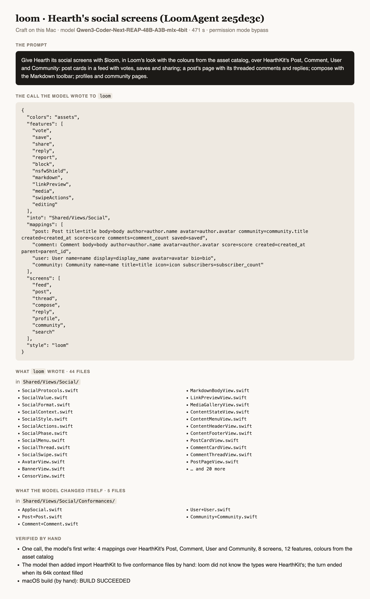
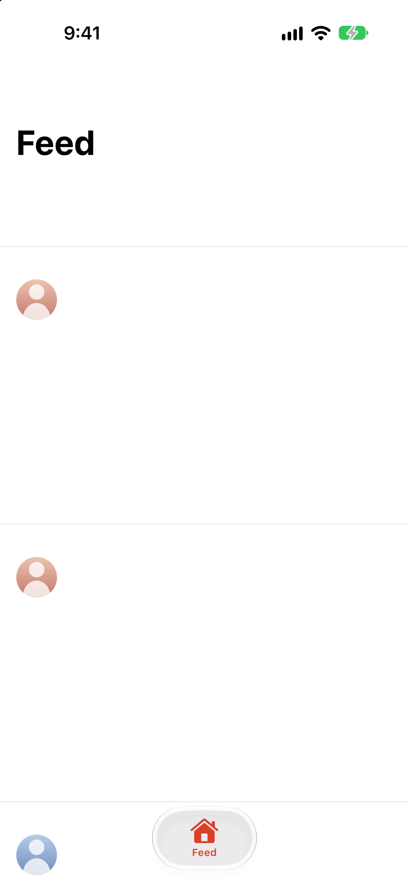
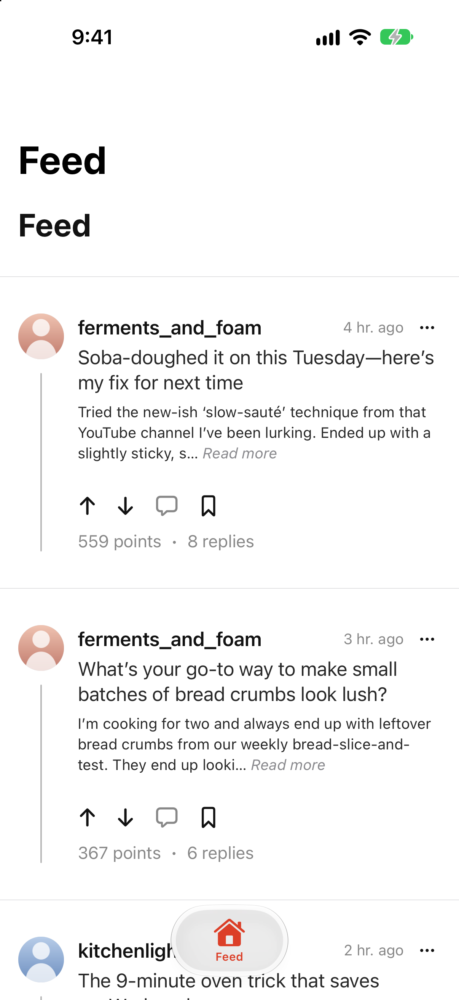
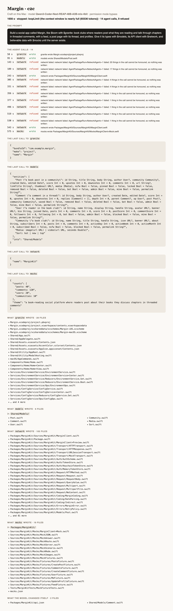
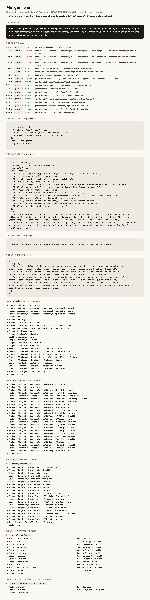
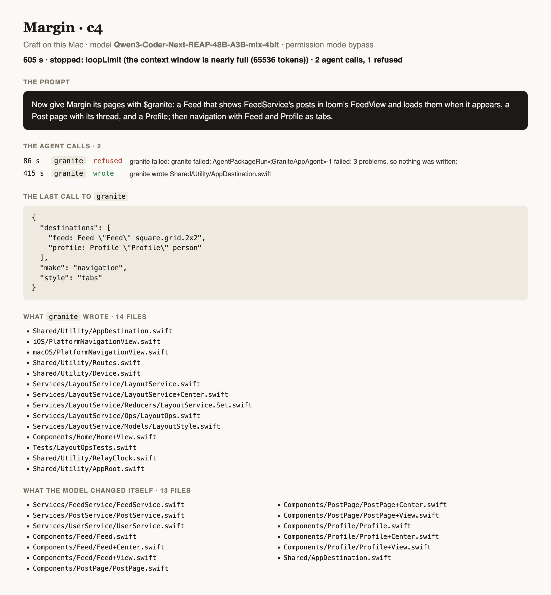
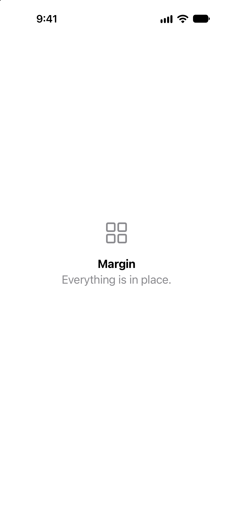
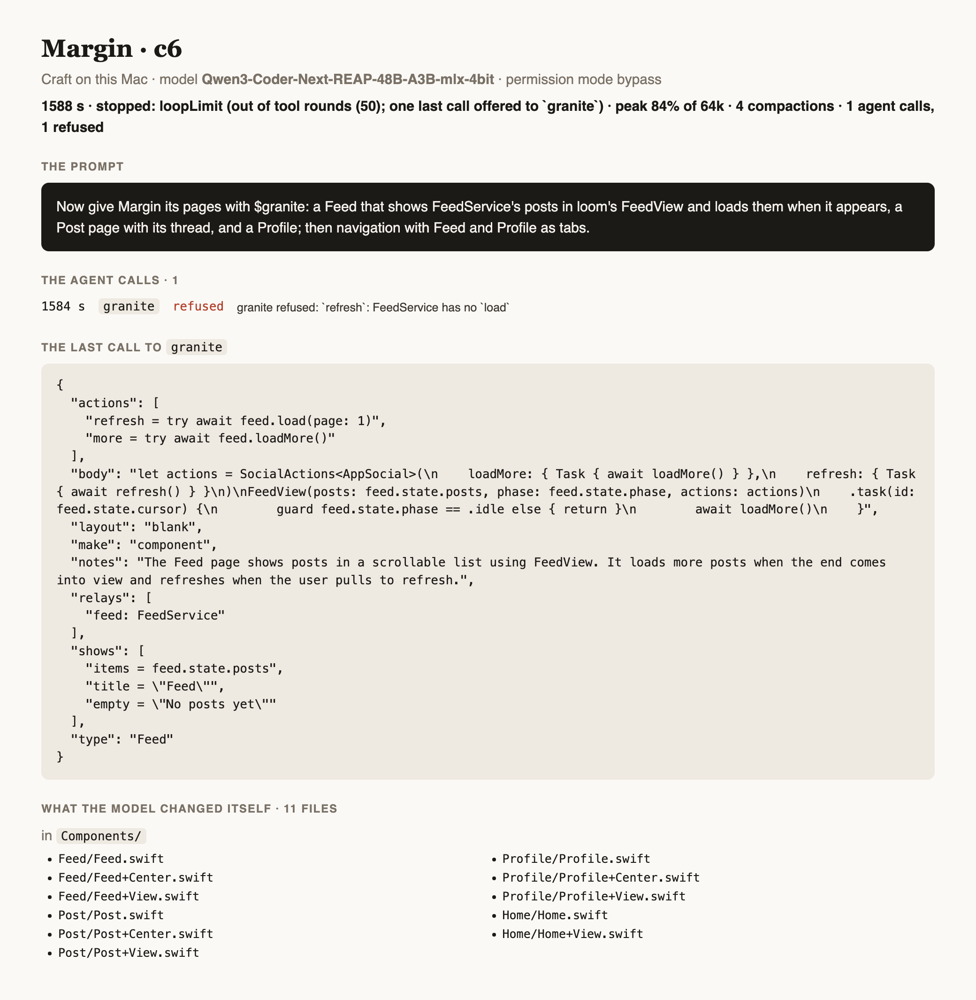
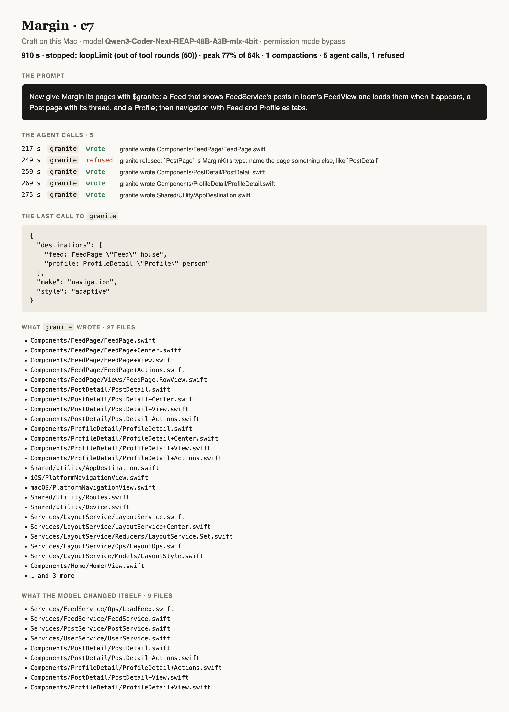

# Testing LoomAgent

How `loom` is tested: its own suite, its gated build of real output, and prompts run through
[Craft](https://github.com/riteshpakala/Craft) on a Mac with Craft's own local model, each logged below verbatim with
what came out. A prompt is run as a person would type it, in a project folder, with `$` naming the agent; nothing is
edited between the prompt and the screenshots. A test that needs a server uses mock backend responses, never a live
service.

## The suite

```
swift test                                  # the record, the schema, the lines, the files, a call through the roster
LOOM_BUILD=1 swift test --filter LoomBuildTests   # the output built for real (gated, minutes)
```

## Prompts run on this Mac

Setup: MacBook Pro M4 Max (128 GB), macOS 27, Xcode 27.1, Craft built from `main`, the model Craft loads
(`rao-studios/Qwen3-Coder-Next-REAP-48B-A3B-mlx-4bit`), permission mode bypass, the agent installed from this repository
with `craft agents add`.

### 1. Hearth's social screens over HearthKit's types (the journey's seventh prompt)

*2026-11-01 · Qwen3-Coder-Next-REAP-48B-A3B-mlx-4bit · 471 s*

**The prompt**, verbatim:

```text
Give Hearth its social screens with $loom, in Loom's look with the colours from the asset catalog, over HearthKit's Post, Comment, User and Community: post cards in a feed with votes, saves and sharing; a post's page with its threaded comments and replies; compose with the Markdown toolbar; profiles and community pages.
```

**The call the model wrote** to `loom`:

```json
{
  "colors": "assets",
  "features": [
    "vote",
    "save",
    "share",
    "reply",
    "report",
    "block",
    "nsfwShield",
    "markdown",
    "linkPreview",
    "media",
    "swipeActions",
    "editing"
  ],
  "into": "Shared/Views/Social",
  "mappings": [
    "post: Post title=title body=body author=author.name avatar=author.avatar community=community.title created=created_at score=score comments=comment_count saved=saved",
    "comment: Comment body=body author=author.name avatar=author.avatar score=score created=created_at parent=parent_id",
    "user: User name=name display=display_name avatar=avatar bio=bio",
    "community: Community name=name title=title icon=icon subscribers=subscriber_count"
  ],
  "screens": [
    "feed",
    "post",
    "thread",
    "compose",
    "reply",
    "profile",
    "community",
    "search"
  ],
  "style": "loom"
}
```

**What `loom` wrote** (44 files): `Shared/Views/Social/SocialProtocols.swift`, `Shared/Views/Social/SocialValue.swift`, `Shared/Views/Social/SocialFormat.swift`, `Shared/Views/Social/SocialContext.swift`, `Shared/Views/Social/SocialStyle.swift`, `Shared/Views/Social/SocialActions.swift`, `Shared/Views/Social/SocialPhase.swift`, `Shared/Views/Social/SocialMenu.swift`, `Shared/Views/Social/SocialThread.swift`, `Shared/Views/Social/SocialSwipe.swift`, `Shared/Views/Social/AvatarView.swift`, `Shared/Views/Social/BannerView.swift`, `Shared/Views/Social/CensorView.swift`, `Shared/Views/Social/MarkdownBodyView.swift`, `Shared/Views/Social/LinkPreviewView.swift`, `Shared/Views/Social/MediaGalleryView.swift`, `Shared/Views/Social/ContentStateView.swift`, `Shared/Views/Social/ContentMenuView.swift`, `Shared/Views/Social/ContentHeaderView.swift`, `Shared/Views/Social/ContentFooterView.swift`, `Shared/Views/Social/PostCardView.swift`, `Shared/Views/Social/CommentCardView.swift`, `Shared/Views/Social/CommentThreadView.swift`, `Shared/Views/Social/PostPageView.swift`, `Shared/Views/Social/FeedHeaderView.swift`, `Shared/Views/Social/FeedView.swift`, `Shared/Views/Social/FeedSplitView.swift`, `Shared/Views/Social/MarkdownEditorView.swift`, `Shared/Views/Social/ComposeView.swift`, `Shared/Views/Social/ReplyView.swift` …

**What the model changed itself**: `Shared/Views/Social/Conformances/AppSocial.swift`, `Shared/Views/Social/Conformances/Post+Post.swift`, `Shared/Views/Social/Conformances/Comment+Comment.swift`, `Shared/Views/Social/Conformances/User+User.swift`, `Shared/Views/Social/Conformances/Community+Community.swift`

**Verified by hand**:
- The macOS scheme builds with the kit and its conformances; the screens are drawn on the app's pages in later entries.


*The turn: one call to loom, the files it wrote, and the imports the model added by hand*

**Notes**:
- The mappings read HearthKit's fields as they are spelled there (`created_at`, `comment_count`: HearthKit was made by a network release that kept the API's snake_case).
- The conformances did not build until the model imported HearthKit into five files: the line gave no `imports`, and loom did not know where Post was declared.
- Fixed in the next release: loom reads the app's own types, imports a mapped type's local package with a note, writes each path in the type's spelling (`created_at` read as `createdAt` where the type says so), and refuses a field the type does not have, listing the ones it has.

## Conformance on Hearth

Level 1 of the regime: the call a model should write, sent straight to the installed runner over its wire
(granite-agent/1) with no model, on a copy of Hearth as the journey left it (services, mock data and loom's views
made), then checked by building, testing and screenshotting the app. A pass here means the agent can produce the
result deterministically; whether Craft's model writes this call is tested by the prompts above.

### The kit with asset colours, before and after the catalog has them

*2026-11-01 · straight to the runner, no model*

**The call**:

```json
{
  "colors": "assets"
}
```

**Checks**:
- Before the colour sets existed, every word drew clear (left out of the catalog): fixed by falling back to the system's colours with a note
- After `assets` wrote the six colors/… sets, the views read them: warm pages and ink in light and dark


*Asset colours the catalog did not have: avatars and no text*


*The system's colours, with the note naming the sets to add*


*The catalog's colours, written by assets*

## Combinations

Level 3 of the regime (`TESTING-REGIME.md`): one prompt chaining agents, run through Craft on a local model, on Margin
(a book-club app made from nothing). The same section is in LoomAgent's and GraniteAgent's TESTING.md, since both are in
every combination. Rows are oldest first, so the fixes read as a before/after line; each run's entry follows the table.

Columns: the sketch and the window; wall seconds, and how many of them were spent inside agents; seconds to the first
agent call; agent calls made / refused / refused then corrected; files the model wrote by hand; the peak prompt
against the window (it can pass 100%: the bound is checked between rounds, and one generation can overrun it) and
how many times the turn made room; how it stopped; the macOS build. The model, the compactions and the
auto-compaction checks are in each run's entry.

| Run | Date | Sketch · window | Wall s (agents) | First agent s | Agents m/r/c | By hand | Peak · room made | Stop | macOS build |
|---|---|---|---|---|---|---|---|---|---|
| [c1](#c1) | 2026-11-01 | off · 64k | 749 (8) | 43 | 13 / 6 / 3 | 15 | 109% · 0 | loopLimit | failed |
| [c2](#c2) | 2026-11-01 | off · 64k | 1510 (823) | 95 | 36 / 21 / 9 | 0 | 95% · 0 | loopLimit | failed |
| [c2b](#c2b) | 2026-11-01 | off · 64k | 1509 (962) | 87 | 25 / 10 / 8 | 1 | 96% · 0 | loopLimit | failed |
| [c2c](#c2c) | 2026-11-01 | off · 64k | 1655 (798) | 58 | 14 / 9 / 2 | 2 | 96% · 0 | loopLimit | failed |
| [c3](#c3) | 2026-11-01 | off · 64k | 1568 (993) | 64 | 11 / 5 / 3 | 4 | 95% · 0 | loopLimit | failed |
| [c3b](#c3b) | 2026-11-01 | off · 64k | 1452 (928) | 63 | 22 / 10 / 6 | 0 | 99% · 0 | loopLimit | failed |
| [c3c](#c3c) | 2026-11-01 | off · 64k | 1155 (458) | 66 | 18 / 4 / 2 | 5 | 99% · 0 | loopLimit | failed |
| [c3d](#c3d) | 2026-11-01 | off · 64k | 1266 (734) | 40 | 15 / 6 / 4 | 3 | 96% · 0 | loopLimit | failed |
| [c3e](#c3e) | 2026-11-01 | off · 64k | 1167 (791) | 63 | 13 / 4 / 3 | 1 | 103% · 0 | loopLimit | failed |
| [c3f](#c3f) | 2026-11-02 | off · 64k | 1436 (763) | 41 | 24 / 14 / 5 | 0 | 106% · 0 | loopLimit | failed |
| [c3g](#c3g) | 2026-11-02 | off · 64k | 1280 (764) | 69 | 15 / 5 / 5 | 1 | 106% · 0 | loopLimit | failed |
| [c4](#c4) | 2026-11-02 | off · 64k | 597 (1) | 86 | 2 / 1 / 1 | 13 | 96% · 0 | loopLimit | failed |
| [c5](#c5) | 2026-11-02 | on · 64k | 1972 (757) | 82 | 20 / 10 / 6 | 3 | 86% · 4 | loopLimit | macOS: succeeded |
| [c6](#c6) | 2026-11-02 | on · 64k | 1588 (1) | 1584 | 1 / 1 / 0 | 11 | 84% · 4 | loopLimit | failed |
| [c7](#c7) | 2026-11-02 | on · 64k | 910 (25) | 217 | 5 / 1 / 1 | 9 | 77% · 1 | loopLimit | failed |

### c1

*2026-11-01 · Qwen3-Coder-Next-REAP-48B-A3B · sketch off · 64k window*

**Prompt**:

> Build a social app called Margin, like $loom with $granite: book clubs where readers post what they are reading and talk through chapters in threaded comments, with a feed, a post page with its thread, and profiles.

**Time**: 749 s in all; 8 s inside agents, 741 s the model and Craft; first agent call at 43 s.

**Calls** (offset s · duration s · result):

- 43 · 0.8 · `granite` ok — granite com.example.margin
- 75 · 0.5 · `models` ok — models
- 97 · 0.0 · `granite` **refused** — granite: granite failed: granite failed: AgentPackageRun<GraniteAppAgent>-1 failed: 1 problem, so nothing was written:
- 118 · 0.0 · `granite` **refused** — granite: granite failed: granite failed: AgentPackageRun<GraniteAppAgent>-1 failed: 1 problem, so nothing was written:
- 144 · 1.0 · `granite` ok — granite
- 166 · 0.0 · `write_file` ok — Shared/Models/SocialPhase.swift
- 221 · 1.7 · `network` ok — network
- 261 · 0.0 · `write_file` ok — Shared/Protocols/SocialActions.swift
- 282 · 0.0 · `loom` **refused** — loom: loom failed: loom failed: AgentPackageRun<LoomAgent>-1 failed: 3 problems with the call, so nothing was written:
- 303 · 0.0 · `loom` **refused** — loom: loom failed: loom failed: AgentPackageRun<LoomAgent>-1 failed: 1 problem with the call, so nothing was written:
- 324 · 1.8 · `loom` ok — loom
- 357 · 0.2 · `granite` **refused** — granite: granite failed: granite failed: AgentPackageRun<GraniteAppAgent>-1 failed: 1 problem, so nothing was written:
- 363 · 0.1 · `granite` **refused** — granite: granite failed: granite failed: AgentPackageRun<GraniteAppAgent>-1 failed: 2 problems, so nothing was written:
- 368 · 0.9 · `granite` ok — granite
- 377 · 0.9 · `granite` ok — granite modals
- 418 · 0.0 · `edit_file` **refused** — Components/Home/Home+View.swift: old_string was not found in the file. You are replacing most of this file — write_file with the full new contents is the tool for that. The closest text is at l
- 438 · 0.0 · `write_file` ok — Components/Home/Home+View.swift
- 593 · 0.0 · `edit_file` ok — Services/SocialService/Reducers/SocialService.LoadFeed.swift
- 599 · 0.0 · `edit_file` ok — Services/SocialService/Reducers/SocialService.LoadPost.swift
- 605 · 0.0 · `edit_file` ok — Services/SocialService/Reducers/SocialService.LoadUser.swift
- 615 · 0.0 · `edit_file` ok — Services/SocialService/Reducers/SocialService.LoadCommunities.swift
- 621 · 0.0 · `edit_file` ok — Services/SocialService/Reducers/SocialService.Comment.swift
- 627 · 0.0 · `edit_file` ok — Services/SocialService/Reducers/SocialService.Follow.swift
- 634 · 0.0 · `edit_file` ok — Services/SocialService/Reducers/SocialService.ReplyTo.swift
- 641 · 0.0 · `edit_file` ok — Services/SocialService/Reducers/SocialService.Save.swift
- 649 · 0.0 · `edit_file` ok — Services/SocialService/Reducers/SocialService.Search.swift
- 656 · 0.0 · `edit_file` ok — Services/SocialService/Reducers/SocialService.Share.swift
- 663 · 0.0 · `edit_file` ok — Services/SocialService/Reducers/SocialService.Subscribe.swift
- 671 · 0.0 · `edit_file` ok — Services/SocialService/Reducers/SocialService.Vote.swift

6 reads, 40 calls in all.

**Who wrote what**:

- `granite`: 71 files — .gitignore, Components/Home/Home+Center.swift, Components/Home/Home+View.swift, Components/Home/Home.swift, Margin.xcodeproj/project.pbxproj, Margin.xcodeproj/project.xcworkspace/contents.xcworkspacedata, Margin.xcodeproj/xcshareddata/xcschemes/Margin-iOS.xcscheme, Margin.xcodeproj/xcshareddata/xcschemes/Margin-macOS.xcscheme …
- `loom`: 44 files — Shared/Views/Social/AvatarView.swift, Shared/Views/Social/BannerView.swift, Shared/Views/Social/CensorView.swift, Shared/Views/Social/CommentCardView.swift, Shared/Views/Social/CommentThreadView.swift, Shared/Views/Social/CommunityCardView.swift, Shared/Views/Social/ComposeView.swift, Shared/Views/Social/Conformances/AppSocial.swift …
- `models`: 5 files — Shared/Models/Comment.swift, Shared/Models/Community.swift, Shared/Models/Media.swift, Shared/Models/Post.swift, Shared/Models/User.swift
- `network`: 47 files — Margin.xcodeproj/project.pbxproj, Packages/SocialAPI/Package.swift, Packages/SocialAPI/Sources/SocialAPI/Auth/AuthScheme.swift, Packages/SocialAPI/Sources/SocialAPI/Auth/KeychainTokenStore.swift, Packages/SocialAPI/Sources/SocialAPI/Auth/MemoryTokenStore.swift, Packages/SocialAPI/Sources/SocialAPI/Auth/TokenStore.swift, Packages/SocialAPI/Sources/SocialAPI/Coding/DateParsing.swift, Packages/SocialAPI/Sources/SocialAPI/Coding/Indirect.swift …
- by hand: 15 files — Components/Home/Home+View.swift, Services/SocialService/Reducers/SocialService.Comment.swift, Services/SocialService/Reducers/SocialService.Follow.swift, Services/SocialService/Reducers/SocialService.LoadCommunities.swift, Services/SocialService/Reducers/SocialService.LoadFeed.swift, Services/SocialService/Reducers/SocialService.LoadPost.swift, Services/SocialService/Reducers/SocialService.LoadUser.swift, Services/SocialService/Reducers/SocialService.ReplyTo.swift, Services/SocialService/Reducers/SocialService.Save.swift, Services/SocialService/Reducers/SocialService.Search.swift

**Window**: peak 109% of 64k; compactions: none; checks: room before the agents pass · no thrash — · compaction works — · the breath —

**Stopped**: loopLimit: the context window is nearly full (65536 tokens)

**Build**: failed
- `macOS build:     |         |- error: value type 'Comment' cannot have a stored property that recursively contains it`
- `error: module 'SocialAPI' has no member named 'loadCommunities'`


*Outcome card for c1*

### c2

*2026-11-01 · Qwen3-Coder-Next-REAP-48B-A3B · sketch off · 64k window*

**Prompt**:

> Build a social app called Margin, like $loom with $granite: book clubs where readers post what they are reading and talk through chapters in threaded comments, with a feed, a post page with its thread, and profiles. Give it its types with $models, its API client with $network, and believable data with $mocks until the server exists.

**Time**: 1510 s in all; 823 s inside agents, 687 s the model and Craft; first agent call at 95 s.

**Calls** (offset s · duration s · result):

- 95 · 1.1 · `granite` ok — granite com.example.margin
- 95 · 0.4 · `models` ok — models
- 95 · 0.0 · `network` **refused** — network bearer: network failed: network failed: AgentPackageRun<NetworkAgent>-1 failed: 19 things in the call cannot be honoured, so nothing was written:
- 138 · 0.0 · `network` **refused** — network bearer: network failed: network failed: AgentPackageRun<NetworkAgent>-1 failed: 17 things in the call cannot be honoured, so nothing was written:
- 149 · 0.4 · `models` ok — models
- 173 · 0.0 · `network` **refused** — network bearer: network failed: network failed: AgentPackageRun<NetworkAgent>-1 failed: 29 things in the call cannot be honoured, so nothing was written:
- 180 · 0.3 · `models` ok — models
- 211 · 0.6 · `models` ok — models
- 238 · 0.0 · `network` **refused** — network bearer: network failed: network failed: AgentPackageRun<NetworkAgent>-1 failed: 29 things in the call cannot be honoured, so nothing was written:
- 274 · 0.0 · `network` **refused** — network bearer: network failed: network failed: AgentPackageRun<NetworkAgent>-1 failed: 25 things in the call cannot be honoured, so nothing was written:
- 310 · 1.6 · `network` ok — network https://api.margin.example
- 349 · 0.0 · `network` **refused** — network bearer: network failed: network failed: AgentPackageRun<NetworkAgent>-1 failed: 5 things in the call cannot be honoured, so nothing was written:
- 373 · 0.0 · `network` **refused** — network bearer: network failed: network failed: AgentPackageRun<NetworkAgent>-1 failed: 5 things in the call cannot be honoured, so nothing was written:
- 397 · 0.0 · `network` **refused** — network bearer: network failed: network failed: AgentPackageRun<NetworkAgent>-1 failed: 3 things in the call cannot be honoured, so nothing was written:
- 419 · 0.0 · `network` **refused** — network bearer: network failed: network failed: AgentPackageRun<NetworkAgent>-1 failed: 5 things in the call cannot be honoured, so nothing was written:
- 441 · 0.0 · `network` **refused** — network bearer: network failed: network failed: AgentPackageRun<NetworkAgent>-1 failed: 1 thing in the call cannot be honoured, so nothing was written:
- 461 · 0.0 · `network` **refused** — network bearer: network failed: network failed: AgentPackageRun<NetworkAgent>-1 failed: 1 thing in the call cannot be honoured, so nothing was written:
- 482 · 2.0 · `network` ok — network bearer
- 509 · 805.4 · `mocks` ok — mocks
- 1339 · 0.3 · `loom` **refused** — loom: loom failed: loom failed: AgentPackageRun<LoomAgent>-1 failed: 6 problems with the call, so nothing was written:
- 1360 · 1.7 · `loom` ok — loom
- 1388 · 0.0 · `granite` **refused** — granite service: granite failed: granite failed: AgentPackageRun<GraniteAppAgent>-1 failed: 1 problem, so nothing was written:
- 1388 · 0.0 · `granite` **refused** — granite service: granite failed: granite failed: AgentPackageRun<GraniteAppAgent>-1 failed: 1 problem, so nothing was written:
- 1388 · 0.0 · `granite` **refused** — granite service: granite failed: granite failed: AgentPackageRun<GraniteAppAgent>-1 failed: 1 problem, so nothing was written:
- 1401 · 0.7 · `granite` ok — granite service
- 1401 · 1.4 · `granite` ok — granite service
- 1401 · 2.1 · `granite` ok — granite service
- 1416 · 0.2 · `granite` **refused** — granite: granite failed: granite failed: AgentPackageRun<GraniteAppAgent>-1 failed: 2 problems, so nothing was written:
- 1428 · 0.2 · `granite` **refused** — granite: granite failed: granite failed: AgentPackageRun<GraniteAppAgent>-1 failed: 2 problems, so nothing was written:
- 1444 · 0.9 · `granite` ok — granite
- 1460 · 0.4 · `granite` **refused** — granite: granite failed: granite failed: AgentPackageRun<GraniteAppAgent>-1 failed: 1 problem, so nothing was written:
- 1460 · 0.2 · `granite` **refused** — granite: granite failed: granite failed: AgentPackageRun<GraniteAppAgent>-1 failed: 1 problem, so nothing was written:
- 1474 · 0.2 · `granite` **refused** — granite: granite failed: granite failed: AgentPackageRun<GraniteAppAgent>-1 failed: 1 problem, so nothing was written:
- 1474 · 0.5 · `granite` **refused** — granite: granite failed: granite failed: AgentPackageRun<GraniteAppAgent>-1 failed: 1 problem, so nothing was written:
- 1488 · 0.8 · `granite` ok — granite
- 1488 · 1.7 · `granite` ok — granite

5 reads, 41 calls in all.

**Who wrote what**:

- `granite`: 51 files — .gitignore, Components/Home/Home+Center.swift, Components/Home/Home+View.swift, Components/Home/Home.swift, Margin.xcodeproj/project.pbxproj, Margin.xcodeproj/project.xcworkspace/contents.xcworkspacedata, Margin.xcodeproj/xcshareddata/xcschemes/Margin-iOS.xcscheme, Margin.xcodeproj/xcshareddata/xcschemes/Margin-macOS.xcscheme …
- `loom`: 49 files — Shared/Views/Social/AvatarView.swift, Shared/Views/Social/BannerView.swift, Shared/Views/Social/CensorView.swift, Shared/Views/Social/CommentCardView.swift, Shared/Views/Social/CommentThreadView.swift, Shared/Views/Social/CommunityCardView.swift, Shared/Views/Social/CommunityPickerView.swift, Shared/Views/Social/CommunitySidebarView.swift …
- `mocks`: 24 files — Packages/MarginKit/Sources/MarginKit/Mocks/Fixtures/CommentsFixture.swift, Packages/MarginKit/Sources/MarginKit/Mocks/Fixtures/CommunitiesFixture.swift, Packages/MarginKit/Sources/MarginKit/Mocks/Fixtures/CreateCommentFixture.swift, Packages/MarginKit/Sources/MarginKit/Mocks/Fixtures/CreateCommunityFixture.swift, Packages/MarginKit/Sources/MarginKit/Mocks/Fixtures/CreatePostFixture.swift, Packages/MarginKit/Sources/MarginKit/Mocks/Fixtures/InstancesFixture.swift, Packages/MarginKit/Sources/MarginKit/Mocks/Fixtures/PostsFixture.swift, Packages/MarginKit/Sources/MarginKit/Mocks/Fixtures/SignInFixture.swift …
- `models`: 21 files — Shared/Models/Comment.swift, Shared/Models/CommentPage.swift, Shared/Models/Community.swift, Shared/Models/CommunityPage.swift, Shared/Models/Instance.swift, Shared/Models/InstancePage.swift, Shared/Models/LoginCredentials.swift, Shared/Models/Media.swift …
- `network`: 61 files — Margin.xcodeproj/project.pbxproj, Packages/MarginKit/Package.swift, Packages/MarginKit/Sources/MarginKit/Auth/AuthScheme.swift, Packages/MarginKit/Sources/MarginKit/Auth/KeychainTokenStore.swift, Packages/MarginKit/Sources/MarginKit/Auth/MemoryTokenStore.swift, Packages/MarginKit/Sources/MarginKit/Auth/TokenStore.swift, Packages/MarginKit/Sources/MarginKit/Coding/DateParsing.swift, Packages/MarginKit/Sources/MarginKit/Coding/Indirect.swift …
- by hand: 0 files

**Window**: peak 95% of 64k; compactions: none; checks: room before the agents pass · no thrash — · compaction works — · the breath —

**Stopped**: loopLimit: the context window is nearly full (65536 tokens)

**Build**: failed
- `macOS build:    |                                                                                          `- error: cannot convert value of type '(MarginClient) -> (Int?, Int?, String?) async throws -> CommunityPage' to closure result type '[Community]'`
- `error: instance member 'posts' of type 'MarginClient' cannot be used on instance of nested type 'PostsService.Load'`


*Outcome card for c2*

### c2b

*2026-11-01 · Qwen3-Coder-Next-REAP-48B-A3B · sketch off · 64k window*

**Prompt**:

> Build a social app called Margin, like $loom with $granite: book clubs where readers post what they are reading and talk through chapters in threaded comments, with a feed, a post page with its thread, and profiles. Give it its types with $models, its API client with $network, and believable data with $mocks until the server exists.

**Time**: 1509 s in all; 962 s inside agents, 546 s the model and Craft; first agent call at 87 s.

**Calls** (offset s · duration s · result):

- 87 · 1.0 · `granite` ok — granite com.example.margin
- 87 · 0.3 · `models` ok — models
- 87 · 0.2 · `network` **refused** — network https://api.margin.example: network failed: network failed: AgentPackageRun<NetworkAgent>-1 failed: 10 things in the call cannot be honoured, so nothing was written:
- 118 · 0.0 · `network` **refused** — network https://api.margin.example: network failed: network failed: AgentPackageRun<NetworkAgent>-1 failed: 9 things in the call cannot be honoured, so nothing was written:
- 145 · 0.0 · `network` **refused** — network https://api.margin.example: network failed: network failed: AgentPackageRun<NetworkAgent>-1 failed: 1 thing in the call cannot be honoured, so nothing was written:
- 171 · 1.7 · `network` ok — network https://api.margin.example
- 198 · 943.3 · `mocks` ok — mocks
- 1269 · 0.0 · `edit_file` ok — Shared/Models/Comment.swift
- 1310 · 1.6 · `loom` ok — loom
- 1341 · 0.0 · `granite` **refused** — granite service: granite failed: granite failed: AgentPackageRun<GraniteAppAgent>-1 failed: 1 problem, so nothing was written:
- 1341 · 0.0 · `granite` **refused** — granite service: granite failed: granite failed: AgentPackageRun<GraniteAppAgent>-1 failed: 1 problem, so nothing was written:
- 1341 · 0.0 · `granite` **refused** — granite service: granite failed: granite failed: AgentPackageRun<GraniteAppAgent>-1 failed: 1 problem, so nothing was written:
- 1354 · 0.6 · `granite` ok — granite service
- 1354 · 1.2 · `granite` ok — granite service
- 1354 · 2.0 · `granite` ok — granite service
- 1385 · 0.4 · `granite` **refused** — granite: granite failed: granite failed: AgentPackageRun<GraniteAppAgent>-1 failed: 3 problems, so nothing was written:
- 1385 · 0.2 · `granite` **refused** — granite: granite failed: granite failed: AgentPackageRun<GraniteAppAgent>-1 failed: 1 problem, so nothing was written:
- 1385 · 0.6 · `granite` **refused** — granite: granite failed: granite failed: AgentPackageRun<GraniteAppAgent>-1 failed: 1 problem, so nothing was written:
- 1405 · 2.1 · `granite` ok — granite
- 1405 · 1.3 · `granite` ok — granite
- 1405 · 0.7 · `granite` ok — granite
- 1439 · 1.3 · `granite` ok — granite
- 1439 · 0.6 · `granite` ok — granite detail
- 1439 · 2.0 · `granite` ok — granite list
- 1457 · 0.2 · `granite` **refused** — granite: granite failed: granite failed: AgentPackageRun<GraniteAppAgent>-1 failed: 1 problem, so nothing was written:
- 1463 · 1.0 · `granite` ok — granite

1 reads, 33 calls in all.

**Who wrote what**:

- `granite`: 72 files — .gitignore, Components/Feed/Feed+Actions.swift, Components/Feed/Feed+Center.swift, Components/Feed/Feed+View.swift, Components/Feed/Feed.swift, Components/Feed/Views/Feed.RowView.swift, Components/Home/Home+Center.swift, Components/Home/Home+View.swift …
- `loom`: 40 files — Shared/Views/Social/AvatarView.swift, Shared/Views/Social/BannerView.swift, Shared/Views/Social/CensorView.swift, Shared/Views/Social/CommentCardView.swift, Shared/Views/Social/CommentThreadView.swift, Shared/Views/Social/ComposeView.swift, Shared/Views/Social/Conformances/AppSocial.swift, Shared/Views/Social/Conformances/Comment+Comment.swift …
- `mocks`: 19 files — Packages/MarginKit/Sources/MarginKit/Mocks/Fixtures/CommentsFixture.swift, Packages/MarginKit/Sources/MarginKit/Mocks/Fixtures/CommunitiesFixture.swift, Packages/MarginKit/Sources/MarginKit/Mocks/Fixtures/CreateCommentFixture.swift, Packages/MarginKit/Sources/MarginKit/Mocks/Fixtures/CreateCommunityFixture.swift, Packages/MarginKit/Sources/MarginKit/Mocks/Fixtures/CreatePostFixture.swift, Packages/MarginKit/Sources/MarginKit/Mocks/Fixtures/PostsFixture.swift, Packages/MarginKit/Sources/MarginKit/Mocks/Fixtures/UserFixture.swift, Packages/MarginKit/Sources/MarginKit/Mocks/Fixtures/UserPostsFixture.swift …
- `models`: 6 files — Shared/Models/Comment.swift, Shared/Models/Community.swift, Shared/Models/Media.swift, Shared/Models/Post.swift, Shared/Models/Sort.swift, Shared/Models/User.swift
- `network`: 49 files — Margin.xcodeproj/project.pbxproj, Packages/MarginKit/Package.swift, Packages/MarginKit/Sources/MarginKit/Auth/AuthScheme.swift, Packages/MarginKit/Sources/MarginKit/Auth/KeychainTokenStore.swift, Packages/MarginKit/Sources/MarginKit/Auth/MemoryTokenStore.swift, Packages/MarginKit/Sources/MarginKit/Auth/TokenStore.swift, Packages/MarginKit/Sources/MarginKit/Coding/DateParsing.swift, Packages/MarginKit/Sources/MarginKit/Coding/Indirect.swift …
- by hand: 1 files — Shared/Models/Comment.swift

**Window**: peak 96% of 64k; compactions: none; checks: room before the agents pass · no thrash — · compaction works — · the breath —

**Stopped**: loopLimit: the context window is nearly full (65536 tokens)

**Build**: failed
- `macOS build:    |                                                                                                               `- error: incorrect argument label in call (have 'page:per_page:', expected 'page:perPage:')`
- `error: value of type 'MarginClient' has no member 'users'`


*Outcome card for c2b*

### c2c

*2026-11-01 · Qwen3-Coder-Next-REAP-48B-A3B · sketch off · 64k window*

**Prompt**:

> Build a social app called Margin, like $loom with $granite: book clubs where readers post what they are reading and talk through chapters in threaded comments, with a feed, a post page with its thread, and profiles. Give it its types with $models, its API client with $network, and believable data with $mocks until the server exists.

**Time**: 1655 s in all; 798 s inside agents, 857 s the model and Craft; first agent call at 58 s.

**Calls** (offset s · duration s · result):

- 58 · 1.1 · `granite` ok — granite com.example.margin
- 95 · 0.4 · `models` ok — models
- 143 · 0.0 · `network` **refused** — network none: network failed: network failed: AgentPackageRun<NetworkAgent>-1 failed: 20 things in the call cannot be honoured, so nothing was written:
- 189 · 0.0 · `network` **refused** — network none: network failed: network failed: AgentPackageRun<NetworkAgent>-1 failed: 17 things in the call cannot be honoured, so nothing was written:
- 243 · 1.7 · `network` ok — network none
- 305 · 0.0 · `network` **refused** — network: network failed: network failed: AgentPackageRun<NetworkAgent>-1 failed: 4 things in the call cannot be honoured, so nothing was written:
- 331 · 0.0 · `network` **refused** — network: network failed: network failed: AgentPackageRun<NetworkAgent>-1 failed: 4 things in the call cannot be honoured, so nothing was written:
- 356 · 0.0 · `network` **refused** — network: network failed: network failed: AgentPackageRun<NetworkAgent>-1 failed: 1 thing in the call cannot be honoured, so nothing was written:
- 377 · 0.0 · `network` **refused** — network: network failed: network failed: AgentPackageRun<NetworkAgent>-1 failed: 1 thing in the call cannot be honoured, so nothing was written:
- 408 · 0.0 · `edit_file` ok — Packages/MarginKit/api.json
- 414 · 0.0 · `edit_file` ok — Packages/MarginKit/api.json
- 493 · 0.0 · `edit_file` **refused** — Packages/MarginKit/api.json: old_string and new_string are the same, so this edit would change nothing. Read the file where the error is and change what is actually wrong there.
- 496 · 0.0 · `network` **refused** — network MarginKit: network failed: network failed: AgentPackageRun<NetworkAgent>-1 failed: 1 thing in the call cannot be honoured, so nothing was written:
- 516 · 0.0 · `edit_file` ok — Packages/MarginKit/api.json
- 519 · 0.0 · `network` **refused** — network MarginKit: network failed: network failed: AgentPackageRun<NetworkAgent>-1 failed: 1 thing in the call cannot be honoured, so nothing was written:
- 527 · 0.0 · `edit_file` ok — Packages/MarginKit/api.json
- 530 · 0.0 · `network` **refused** — network MarginKit: network failed: network failed: AgentPackageRun<NetworkAgent>-1 failed: 1 thing in the call cannot be honoured, so nothing was written:
- 540 · 0.0 · `edit_file` ok — Packages/MarginKit/api.json
- 543 · 2.3 · `network` ok — network MarginKit
- 575 · 792.3 · `mocks` ok — mocks
- 1638 · 0.0 · `edit_file` ok — Shared/Models/Comment.swift

3 reads, 27 calls in all.

**Who wrote what**:

- `granite`: 28 files — .gitignore, Components/Home/Home+Center.swift, Components/Home/Home+View.swift, Components/Home/Home.swift, Margin.xcodeproj/project.pbxproj, Margin.xcodeproj/project.xcworkspace/contents.xcworkspacedata, Margin.xcodeproj/xcshareddata/xcschemes/Margin-iOS.xcscheme, Margin.xcodeproj/xcshareddata/xcschemes/Margin-macOS.xcscheme …
- `mocks`: 19 files — Packages/MarginKit/Sources/MarginKit/Mocks/Fixtures/CommentsFixture.swift, Packages/MarginKit/Sources/MarginKit/Mocks/Fixtures/CreateCommentFixture.swift, Packages/MarginKit/Sources/MarginKit/Mocks/Fixtures/CreatePostFixture.swift, Packages/MarginKit/Sources/MarginKit/Mocks/Fixtures/FeedFixture.swift, Packages/MarginKit/Sources/MarginKit/Mocks/Fixtures/MeFixture.swift, Packages/MarginKit/Sources/MarginKit/Mocks/Fixtures/PostsFixture.swift, Packages/MarginKit/Sources/MarginKit/Mocks/Fixtures/UpdateProfileFixture.swift, Packages/MarginKit/Sources/MarginKit/Mocks/Fixtures/UserFixture.swift …
- `models`: 6 files — Shared/Models/Comment.swift, Shared/Models/Community.swift, Shared/Models/Media.swift, Shared/Models/Post.swift, Shared/Models/Sort.swift, Shared/Models/User.swift
- `network`: 60 files — Margin.xcodeproj/project.pbxproj, Packages/MarginKit/Package.swift, Packages/MarginKit/Sources/MarginKit/Auth/AuthScheme.swift, Packages/MarginKit/Sources/MarginKit/Auth/KeychainTokenStore.swift, Packages/MarginKit/Sources/MarginKit/Auth/MemoryTokenStore.swift, Packages/MarginKit/Sources/MarginKit/Auth/TokenStore.swift, Packages/MarginKit/Sources/MarginKit/Coding/DateParsing.swift, Packages/MarginKit/Sources/MarginKit/Coding/Indirect.swift …
- by hand: 2 files — Packages/MarginKit/api.json, Shared/Models/Comment.swift

**Window**: peak 96% of 64k; compactions: none; checks: room before the agents **fail** · no thrash — · compaction works — · the breath —

**Stopped**: loopLimit: the context window is nearly full (65536 tokens)

**Build**: failed
- `Shared/Models/Comment.swift:4:7: error: type 'Comment' does not conform to protocol 'Equatable'`
- `Shared/Models/Comment.swift:4:7: error: type 'Comment' does not conform to protocol 'Hashable'`


*Outcome card for c2c*

### c3

*2026-11-01 · Qwen3-Coder-Next-REAP-48B-A3B · sketch off · 64k window*

**Prompt**:

> Build a social app called Margin, like $loom with $granite: book clubs where readers post what they are reading and talk through chapters in threaded comments, with a feed, a post page with its thread, and profiles. Its API client and types come from $network, and believable data from $mocks until the server exists.

**Time**: 1568 s in all; 993 s inside agents, 575 s the model and Craft; first agent call at 64 s.

**Calls** (offset s · duration s · result):

- 64 · 0.9 · `granite` ok — granite com.example.margin
- 96 · 0.2 · `models` **refused** — models: models failed: models failed: AgentPackageRun<ModelsAgent>-1 failed: 1 lines are not understood, so nothing was written:
- 121 · 0.3 · `models` ok — models
- 147 · 0.0 · `network` **refused** — network bearer: network failed: network failed: AgentPackageRun<NetworkAgent>-1 failed: 15 things in the call cannot be honoured, so nothing was written:
- 188 · 0.0 · `network` **refused** — network bearer: network failed: network failed: AgentPackageRun<NetworkAgent>-1 failed: 3 things in the call cannot be honoured, so nothing was written:
- 228 · 0.0 · `network` **refused** — network bearer: network failed: network failed: AgentPackageRun<NetworkAgent>-1 failed: 2 things in the call cannot be honoured, so nothing was written:
- 268 · 1.8 · `network` ok — network bearer
- 296 · 986.0 · `mocks` ok — mocks
- 1298 · 0.3 · `loom` **refused** — loom: loom failed: loom failed: AgentPackageRun<LoomAgent>-1 failed: 8 problems with the call, so nothing was written:
- 1312 · 1.5 · `loom` ok — loom
- 1329 · 1.5 · `granite` ok — granite
- 1429 · 0.0 · `edit_file` ok — Shared/Views/Social/Conformances/Post+Post.swift
- 1464 · 0.0 · `edit_file` ok — Shared/Views/Social/Conformances/Comment+Comment.swift
- 1497 · 0.0 · `edit_file` ok — Shared/Views/Social/Conformances/Community+Community.swift
- 1534 · 0.0 · `edit_file` ok — Shared/Views/Social/Conformances/User+User.swift

4 reads, 25 calls in all.

**Who wrote what**:

- `granite`: 40 files — .gitignore, Components/Home/Home+Center.swift, Components/Home/Home+View.swift, Components/Home/Home.swift, Margin.xcodeproj/project.pbxproj, Margin.xcodeproj/project.xcworkspace/contents.xcworkspacedata, Margin.xcodeproj/xcshareddata/xcschemes/Margin-iOS.xcscheme, Margin.xcodeproj/xcshareddata/xcschemes/Margin-macOS.xcscheme …
- `loom`: 40 files — Shared/Views/Social/AvatarView.swift, Shared/Views/Social/BannerView.swift, Shared/Views/Social/CensorView.swift, Shared/Views/Social/CommentCardView.swift, Shared/Views/Social/CommentThreadView.swift, Shared/Views/Social/ComposeView.swift, Shared/Views/Social/Conformances/AppSocial.swift, Shared/Views/Social/Conformances/Comment+Comment.swift …
- `mocks`: 21 files — Packages/MarginKit/Sources/MarginKit/Mocks/Fixtures/CommentsFixture.swift, Packages/MarginKit/Sources/MarginKit/Mocks/Fixtures/CommunitiesFixture.swift, Packages/MarginKit/Sources/MarginKit/Mocks/Fixtures/CreateCommunityFixture.swift, Packages/MarginKit/Sources/MarginKit/Mocks/Fixtures/CreatePostFixture.swift, Packages/MarginKit/Sources/MarginKit/Mocks/Fixtures/CurrentSessionFixture.swift, Packages/MarginKit/Sources/MarginKit/Mocks/Fixtures/LoginFixture.swift, Packages/MarginKit/Sources/MarginKit/Mocks/Fixtures/PostsFixture.swift, Packages/MarginKit/Sources/MarginKit/Mocks/Fixtures/ReplyToPostFixture.swift …
- `models`: 6 files — Shared/Models/Book.swift, Shared/Models/Comment.swift, Shared/Models/Community.swift, Shared/Models/Media.swift, Shared/Models/Post.swift, Shared/Models/User.swift
- `network`: 55 files — Margin.xcodeproj/project.pbxproj, Packages/MarginKit/Package.swift, Packages/MarginKit/Sources/MarginKit/Auth/AuthScheme.swift, Packages/MarginKit/Sources/MarginKit/Auth/KeychainTokenStore.swift, Packages/MarginKit/Sources/MarginKit/Auth/MemoryTokenStore.swift, Packages/MarginKit/Sources/MarginKit/Auth/TokenStore.swift, Packages/MarginKit/Sources/MarginKit/Coding/DateParsing.swift, Packages/MarginKit/Sources/MarginKit/Coding/MarginCoding.swift …
- by hand: 4 files — Shared/Views/Social/Conformances/Comment+Comment.swift, Shared/Views/Social/Conformances/Community+Community.swift, Shared/Views/Social/Conformances/Post+Post.swift, Shared/Views/Social/Conformances/User+User.swift

**Window**: peak 95% of 64k; compactions: none; checks: room before the agents pass · no thrash — · compaction works — · the breath —

**Stopped**: loopLimit: the context window is nearly full (65536 tokens)

**Build**: failed
- `Shared/Utility/AppDestination.swift:39:21: error: generic parameter 'Social' could not be inferred`
- `Shared/Utility/AppDestination.swift:39:29: error: missing arguments for parameters 'posts', 'actions' in call`


*Outcome card for c3*

### c3b

*2026-11-01 · Qwen3-Coder-Next-REAP-48B-A3B · sketch off · 64k window*

**Prompt**:

> Build a social app called Margin, like $loom with $granite: book clubs where readers post what they are reading and talk through chapters in threaded comments, with a feed, a post page with its thread, and profiles. Its API client and types come from $network, and believable data from $mocks until the server exists.

**Time**: 1452 s in all; 928 s inside agents, 524 s the model and Craft; first agent call at 63 s.

**Calls** (offset s · duration s · result):

- 63 · 0.9 · `granite` ok — granite com.example.margin
- 89 · 0.0 · `models` **refused** — models: models failed: models failed: AgentPackageRun<ModelsAgent>-1 failed: 1 lines are not understood, so nothing was written:
- 109 · 0.3 · `models` ok — models
- 139 · 0.0 · `network` **refused** — network none: network failed: network failed: AgentPackageRun<NetworkAgent>-1 failed: 16 things in the call cannot be honoured, so nothing was written:
- 182 · 1.8 · `network` ok — network none
- 201 · 917.5 · `mocks` ok — mocks
- 1140 · 0.0 · `loom` **refused** — loom: loom failed: loom failed: AgentPackageRun<LoomAgent>-1 failed: 2 problems with the call, so nothing was written:
- 1156 · 1.6 · `loom` ok — loom
- 1176 · 0.2 · `granite` **refused** — granite: granite failed: granite failed: AgentPackageRun<GraniteAppAgent>-1 failed: 4 problems, so nothing was written:
- 1183 · 0.2 · `granite` **refused** — granite: granite failed: granite failed: AgentPackageRun<GraniteAppAgent>-1 failed: 1 problem, so nothing was written:
- 1191 · 0.0 · `granite` **refused** — granite: granite failed: granite failed: AgentPackageRun<GraniteAppAgent>-1 failed: 1 problem, so nothing was written:
- 1198 · 0.2 · `granite` **refused** — granite: granite failed: granite failed: AgentPackageRun<GraniteAppAgent>-1 failed: 2 problems, so nothing was written:
- 1206 · 0.8 · `granite` ok — granite
- 1216 · 0.7 · `granite` ok — granite
- 1224 · 0.6 · `granite` ok — granite detail
- 1232 · 0.2 · `granite` **refused** — granite detail: granite failed: granite failed: AgentPackageRun<GraniteAppAgent>-1 failed: 1 problem, so nothing was written:
- 1238 · 0.7 · `granite` ok — granite
- 1247 · 0.6 · `granite` ok — granite detail
- 1255 · 0.6 · `granite` ok — granite search
- 1263 · 0.2 · `granite` **refused** — granite: granite failed: granite failed: AgentPackageRun<GraniteAppAgent>-1 failed: 2 problems, so nothing was written:
- 1269 · 0.2 · `granite` **refused** — granite: granite failed: granite failed: AgentPackageRun<GraniteAppAgent>-1 failed: 2 problems, so nothing was written:
- 1275 · 1.0 · `granite` ok — granite

1 reads, 35 calls in all.

**Who wrote what**:

- `granite`: 69 files — .gitignore, Components/Feed/Feed+Actions.swift, Components/Feed/Feed+Center.swift, Components/Feed/Feed+View.swift, Components/Feed/Feed.swift, Components/Feed/Views/Feed.RowView.swift, Components/Home/Home+Center.swift, Components/Home/Home+View.swift …
- `loom`: 44 files — Shared/Views/Social/AvatarView.swift, Shared/Views/Social/BannerView.swift, Shared/Views/Social/CensorView.swift, Shared/Views/Social/CommentCardView.swift, Shared/Views/Social/CommentThreadView.swift, Shared/Views/Social/CommunityCardView.swift, Shared/Views/Social/ComposeView.swift, Shared/Views/Social/Conformances/AppSocial.swift …
- `mocks`: 23 files — Packages/MarginKit/Sources/MarginKit/Mocks/Fixtures/BooksFixture.swift, Packages/MarginKit/Sources/MarginKit/Mocks/Fixtures/CommentsFixture.swift, Packages/MarginKit/Sources/MarginKit/Mocks/Fixtures/CommunitiesFixture.swift, Packages/MarginKit/Sources/MarginKit/Mocks/Fixtures/CreateBookFixture.swift, Packages/MarginKit/Sources/MarginKit/Mocks/Fixtures/CreateCommentFixture.swift, Packages/MarginKit/Sources/MarginKit/Mocks/Fixtures/CreateCommunityFixture.swift, Packages/MarginKit/Sources/MarginKit/Mocks/Fixtures/CreatePostFixture.swift, Packages/MarginKit/Sources/MarginKit/Mocks/Fixtures/PostsFixture.swift …
- `models`: 6 files — Shared/Models/Book.swift, Shared/Models/Comment.swift, Shared/Models/Community.swift, Shared/Models/Media.swift, Shared/Models/Post.swift, Shared/Models/User.swift
- `network`: 57 files — Margin.xcodeproj/project.pbxproj, Packages/MarginKit/Package.swift, Packages/MarginKit/Sources/MarginKit/Auth/AuthScheme.swift, Packages/MarginKit/Sources/MarginKit/Auth/KeychainTokenStore.swift, Packages/MarginKit/Sources/MarginKit/Auth/MemoryTokenStore.swift, Packages/MarginKit/Sources/MarginKit/Auth/TokenStore.swift, Packages/MarginKit/Sources/MarginKit/Coding/DateParsing.swift, Packages/MarginKit/Sources/MarginKit/Coding/MarginCoding.swift …
- by hand: 0 files

**Window**: peak 99% of 64k; compactions: none; checks: room before the agents pass · no thrash — · compaction works — · the breath —

**Stopped**: loopLimit: the context window is nearly full (65536 tokens)

**Build**: failed
- `Services/PostsService/Reducers/PostsService.Load.swift:31:21: error: failed to produce diagnostic for expression; please submit a bug report (https://swift.org/contributing/#reporting-bugs)`
- `Services/PostsService/Reducers/PostsService.More.swift:31:21: error: failed to produce diagnostic for expression; please submit a bug report (https://swift.org/contributing/#reporting-bugs)`
- `Services/UsersService/Reducers/UsersService.Load.swift:33:78: error: cannot convert value of type 'User' to closure result type 'User?'`


*Outcome card for c3b*

### c3c

*2026-11-01 · Qwen3-Coder-Next-REAP-48B-A3B · sketch off · 64k window*

**Prompt**:

> Build a social app called Margin, like $loom with $granite: book clubs where readers post what they are reading and talk through chapters in threaded comments, with a feed, a post page with its thread, and profiles. Its API client and types come from $network, and believable data from $mocks until the server exists.

**Time**: 1155 s in all; 458 s inside agents, 696 s the model and Craft; first agent call at 66 s.

**Calls** (offset s · duration s · result):

- 66 · 0.9 · `granite` ok — granite com.example.margin
- 114 · 0.1 · `network` **refused** — network bearer: network failed: network failed: AgentPackageRun<NetworkAgent>-1 failed: 5 things in the call cannot be honoured, so nothing was written:
- 160 · 0.0 · `network` **refused** — network bearer: network failed: network failed: AgentPackageRun<NetworkAgent>-1 failed: 1 thing in the call cannot be honoured, so nothing was written:
- 201 · 0.0 · `network` **refused** — network bearer: network failed: network failed: AgentPackageRun<NetworkAgent>-1 failed: 2 things in the call cannot be honoured, so nothing was written:
- 244 · 1.7 · `network` ok — network bearer
- 274 · 446.3 · `mocks` ok — mocks a book club social platform where readers discuss books in threa
- 736 · 1.8 · `loom` ok — loom
- 756 · 0.2 · `granite` **refused** — granite service: granite failed: granite failed: AgentPackageRun<GraniteAppAgent>-1 failed: 2 problems, so nothing was written:
- 762 · 0.6 · `granite` ok — granite service
- 771 · 0.7 · `granite` ok — granite service
- 785 · 0.7 · `granite` ok — granite service
- 794 · 0.6 · `granite` ok — granite
- 804 · 0.6 · `granite` ok — granite
- 813 · 0.6 · `granite` ok — granite
- 824 · 0.7 · `granite` ok — granite
- 836 · 0.7 · `granite` ok — granite
- 848 · 0.8 · `granite` ok — granite
- 858 · 1.1 · `granite` ok — granite
- 970 · 0.0 · `edit_file` ok — Shared/Views/Social/Conformances/AppSocial.swift
- 1004 · 0.0 · `edit_file` ok — Shared/Views/Social/Conformances/Post+Post.swift
- 1035 · 0.0 · `edit_file` ok — Shared/Views/Social/Conformances/Comment+Comment.swift
- 1069 · 0.0 · `edit_file` ok — Shared/Views/Social/Conformances/User+User.swift
- 1103 · 0.0 · `edit_file` ok — Shared/Views/Social/Conformances/Community+Community.swift

5 reads, 33 calls in all.

**Who wrote what**:

- `granite`: 85 files — .gitignore, Components/CommunityListPage/CommunityListPage+Actions.swift, Components/CommunityListPage/CommunityListPage+Center.swift, Components/CommunityListPage/CommunityListPage+View.swift, Components/CommunityListPage/CommunityListPage.swift, Components/CommunityListPage/Views/CommunityListPage.RowView.swift, Components/CommunityPage/CommunityPage+Actions.swift, Components/CommunityPage/CommunityPage+Center.swift …
- `loom`: 48 files — Shared/Views/Social/AvatarView.swift, Shared/Views/Social/BannerView.swift, Shared/Views/Social/CensorView.swift, Shared/Views/Social/CommentCardView.swift, Shared/Views/Social/CommentThreadView.swift, Shared/Views/Social/CommunityCardView.swift, Shared/Views/Social/CommunityPickerView.swift, Shared/Views/Social/CommunitySidebarView.swift …
- `mocks`: 21 files — Packages/MarginKit/Sources/MarginKit/Mocks/Fixtures/CommentsFixture.swift, Packages/MarginKit/Sources/MarginKit/Mocks/Fixtures/CommunitiesFixture.swift, Packages/MarginKit/Sources/MarginKit/Mocks/Fixtures/CreateCommunityFixture.swift, Packages/MarginKit/Sources/MarginKit/Mocks/Fixtures/CreatePostFixture.swift, Packages/MarginKit/Sources/MarginKit/Mocks/Fixtures/PostsFixture.swift, Packages/MarginKit/Sources/MarginKit/Mocks/Fixtures/ReplyToPostFixture.swift, Packages/MarginKit/Sources/MarginKit/Mocks/Fixtures/SignInFixture.swift, Packages/MarginKit/Sources/MarginKit/Mocks/Fixtures/SignUpFixture.swift …
- `network`: 54 files — Margin.xcodeproj/project.pbxproj, Packages/MarginKit/Package.swift, Packages/MarginKit/Sources/MarginKit/Auth/AuthScheme.swift, Packages/MarginKit/Sources/MarginKit/Auth/KeychainTokenStore.swift, Packages/MarginKit/Sources/MarginKit/Auth/MemoryTokenStore.swift, Packages/MarginKit/Sources/MarginKit/Auth/TokenStore.swift, Packages/MarginKit/Sources/MarginKit/Coding/DateParsing.swift, Packages/MarginKit/Sources/MarginKit/Coding/Indirect.swift …
- by hand: 5 files — Shared/Views/Social/Conformances/AppSocial.swift, Shared/Views/Social/Conformances/Comment+Comment.swift, Shared/Views/Social/Conformances/Community+Community.swift, Shared/Views/Social/Conformances/Post+Post.swift, Shared/Views/Social/Conformances/User+User.swift

**Window**: peak 99% of 64k; compactions: none; checks: room before the agents pass · no thrash — · compaction works — · the breath —

**Stopped**: loopLimit: the context window is nearly full (65536 tokens)

**Build**: failed
- `macOS build:    |                                                                      `- error: value of type 'Comment' has no member 'community'`
- `error: value of optional type 'User?' must be unwrapped to refer to member 'avatar' of wrapped base type 'User'`


*Outcome card for c3c*

### c3d

*2026-11-01 · Qwen3-Coder-Next-REAP-48B-A3B · sketch off · 64k window*

**Prompt**:

> Build a social app called Margin, like $loom with $granite: book clubs where readers post what they are reading and talk through chapters in threaded comments, with a feed, a post page with its thread, and profiles. Its API client and types come from $network, and believable data from $mocks until the server exists.

**Time**: 1266 s in all; 734 s inside agents, 532 s the model and Craft; first agent call at 40 s.

**Calls** (offset s · duration s · result):

- 40 · 0.8 · `granite` ok — granite com.example.margin
- 83 · 0.3 · `network` **refused** — network bearer: network failed: network failed: AgentPackageRun<NetworkAgent>-1 failed: 4 things in the call cannot be honoured, so nothing was written:
- 123 · 1.7 · `network` ok — network bearer
- 153 · 677.7 · `mocks` ok — mocks
- 851 · 0.3 · `loom` **refused** — loom: loom failed: loom failed: AgentPackageRun<LoomAgent>-1 failed: 13 problems with the call, so nothing was written:
- 865 · 0.0 · `loom` **refused** — loom: loom failed: loom failed: AgentPackageRun<LoomAgent>-1 failed: 1 problem with the call, so nothing was written:
- 877 · 0.0 · `loom` **refused** — loom: loom failed: loom failed: AgentPackageRun<LoomAgent>-1 failed: 1 problem with the call, so nothing was written:
- 889 · 1.7 · `loom` ok — loom
- 908 · 0.0 · `granite` **refused** — granite service: granite failed: granite failed: AgentPackageRun<GraniteAppAgent>-1 failed: 1 problem, so nothing was written:
- 913 · 0.7 · `granite` ok — granite service
- 919 · 0.3 · `granite` **refused** — granite: granite failed: granite failed: AgentPackageRun<GraniteAppAgent>-1 failed: 3 problems, so nothing was written:
- 926 · 8.6 · `granite` ok — granite
- 939 · 22.6 · `granite` ok — granite blank
- 965 · 17.9 · `granite` ok — granite blank
- 989 · 1.0 · `granite` ok — granite
- 1136 · 0.0 · `edit_file` ok — /tmp/claude-501/-Users-ritesh-Documents-repositories-Craft/1ec12cb8-ba
- 1202 · 0.0 · `edit_file` ok — /tmp/claude-501/-Users-ritesh-Documents-repositories-Craft/1ec12cb8-ba
- 1258 · 0.0 · `edit_file` ok — /tmp/claude-501/-Users-ritesh-Documents-repositories-Craft/1ec12cb8-ba

3 reads, 24 calls in all.

**Who wrote what**:

- `granite`: 55 files — .gitignore, Components/Feed/Feed+Actions.swift, Components/Feed/Feed+Center.swift, Components/Feed/Feed+View.swift, Components/Feed/Feed.swift, Components/Home/Home+Center.swift, Components/Home/Home+View.swift, Components/Home/Home.swift …
- `loom`: 48 files — Shared/Views/Social/AvatarView.swift, Shared/Views/Social/BannerView.swift, Shared/Views/Social/CensorView.swift, Shared/Views/Social/CommentCardView.swift, Shared/Views/Social/CommentThreadView.swift, Shared/Views/Social/CommunityCardView.swift, Shared/Views/Social/CommunityPickerView.swift, Shared/Views/Social/CommunitySidebarView.swift …
- `mocks`: 23 files — Packages/MarginKit/Sources/MarginKit/Mocks/Fixtures/CommentsFixture.swift, Packages/MarginKit/Sources/MarginKit/Mocks/Fixtures/CommunitiesFixture.swift, Packages/MarginKit/Sources/MarginKit/Mocks/Fixtures/CreateCommunityFixture.swift, Packages/MarginKit/Sources/MarginKit/Mocks/Fixtures/CreatePostFixture.swift, Packages/MarginKit/Sources/MarginKit/Mocks/Fixtures/CurrentUserFixture.swift, Packages/MarginKit/Sources/MarginKit/Mocks/Fixtures/FeedFixture.swift, Packages/MarginKit/Sources/MarginKit/Mocks/Fixtures/PostsFixture.swift, Packages/MarginKit/Sources/MarginKit/Mocks/Fixtures/ReplyFixture.swift …
- `network`: 55 files — Margin.xcodeproj/project.pbxproj, Packages/MarginKit/Package.swift, Packages/MarginKit/Sources/MarginKit/Auth/AuthScheme.swift, Packages/MarginKit/Sources/MarginKit/Auth/KeychainTokenStore.swift, Packages/MarginKit/Sources/MarginKit/Auth/MemoryTokenStore.swift, Packages/MarginKit/Sources/MarginKit/Auth/TokenStore.swift, Packages/MarginKit/Sources/MarginKit/Coding/DateParsing.swift, Packages/MarginKit/Sources/MarginKit/Coding/Indirect.swift …
- by hand: 3 files — Components/Feed/Feed+View.swift, Components/Profile/Profile+View.swift, Components/Search/Search+View.swift

**Window**: peak 96% of 64k; compactions: none; checks: room before the agents pass · no thrash — · compaction works — · the breath —

**Stopped**: loopLimit: the context window is nearly full (65536 tokens)

**Build**: failed
- `macOS build:    |                                                                       `- error: cannot convert value of type 'Int' to expected argument type 'String'`
- `error: cannot convert value of type 'URL?' to expected argument type 'String?'`


*Outcome card for c3d*

### c3e

*2026-11-01 · Qwen3-Coder-Next-REAP-48B-A3B · sketch off · 64k window*

**Prompt**:

> Build a social app called Margin, like $loom with $granite: book clubs where readers post what they are reading and talk through chapters in threaded comments, with a feed, a post page with its thread, and profiles. Its API client and types come from $network, and believable data from $mocks until the server exists.

**Time**: 1167 s in all; 791 s inside agents, 377 s the model and Craft; first agent call at 63 s.

**Calls** (offset s · duration s · result):

- 63 · 1.0 · `granite` ok — granite com.example.margin
- 105 · 0.0 · `network` **refused** — network bearer: network failed: network failed: AgentPackageRun<NetworkAgent>-1 failed: 10 things in the call cannot be honoured, so nothing was written:
- 145 · 1.8 · `network` ok — network bearer
- 169 · 745.9 · `mocks` ok — mocks
- 932 · 1.8 · `loom` ok — loom
- 950 · 0.0 · `granite` **refused** — granite service: granite failed: granite failed: AgentPackageRun<GraniteAppAgent>-1 failed: 1 problem, so nothing was written:
- 954 · 0.6 · `granite` ok — granite service
- 961 · 0.6 · `granite` ok — granite list
- 967 · 0.6 · `granite` ok — granite detail
- 972 · 0.2 · `granite` **refused** — granite: granite failed: granite failed: AgentPackageRun<GraniteAppAgent>-1 failed: 1 problem, so nothing was written:
- 975 · 24.4 · `granite` **refused** — granite blank: granite failed: granite failed: AgentPackageRun<GraniteAppAgent>-1 failed: 1 problem, so nothing was written:
- 1004 · 12.7 · `granite` ok — granite
- 1022 · 0.9 · `granite` ok — granite
- 1101 · 0.0 · `edit_file` ok — /tmp/claude-501/-Users-ritesh-Documents-repositories-Craft/1ec12cb8-ba

1 reads, 20 calls in all.

**Who wrote what**:

- `granite`: 57 files — .gitignore, Components/FeedPage/FeedPage+Center.swift, Components/FeedPage/FeedPage+View.swift, Components/FeedPage/FeedPage.swift, Components/FeedPage/Views/FeedPage.RowView.swift, Components/Home/Home+Center.swift, Components/Home/Home+View.swift, Components/Home/Home.swift …
- `loom`: 42 files — Shared/Views/Social/AvatarView.swift, Shared/Views/Social/BannerView.swift, Shared/Views/Social/CensorView.swift, Shared/Views/Social/CommentCardView.swift, Shared/Views/Social/CommentThreadView.swift, Shared/Views/Social/CommunityCardView.swift, Shared/Views/Social/ComposeView.swift, Shared/Views/Social/Conformances/AppSocial.swift …
- `mocks`: 21 files — Packages/MarginKit/Sources/MarginKit/Mocks/Fixtures/CommentsFixture.swift, Packages/MarginKit/Sources/MarginKit/Mocks/Fixtures/CommunitiesFixture.swift, Packages/MarginKit/Sources/MarginKit/Mocks/Fixtures/CreateCommunityFixture.swift, Packages/MarginKit/Sources/MarginKit/Mocks/Fixtures/CreatePostFixture.swift, Packages/MarginKit/Sources/MarginKit/Mocks/Fixtures/FeedFixture.swift, Packages/MarginKit/Sources/MarginKit/Mocks/Fixtures/LoginFixture.swift, Packages/MarginKit/Sources/MarginKit/Mocks/Fixtures/RegisterFixture.swift, Packages/MarginKit/Sources/MarginKit/Mocks/Fixtures/ReplyToPostFixture.swift …
- `network`: 56 files — Margin.xcodeproj/project.pbxproj, Packages/MarginKit/Package.swift, Packages/MarginKit/Sources/MarginKit/Auth/AuthScheme.swift, Packages/MarginKit/Sources/MarginKit/Auth/KeychainTokenStore.swift, Packages/MarginKit/Sources/MarginKit/Auth/MemoryTokenStore.swift, Packages/MarginKit/Sources/MarginKit/Auth/TokenStore.swift, Packages/MarginKit/Sources/MarginKit/Coding/DateParsing.swift, Packages/MarginKit/Sources/MarginKit/Coding/MarginCoding.swift …
- by hand: 1 files — Shared/Views/Social/Conformances/Comment+Comment.swift

**Window**: peak 103% of 64k; compactions: none; checks: room before the agents pass · no thrash — · compaction works — · the breath —

**Stopped**: loopLimit: the context window is nearly full (65536 tokens)

**Build**: failed
- `Components/ProfilePage/ProfilePage+Actions.swift:7:24: error: value of type 'FeedService' has no member 'load'`
- `Components/ProfilePage/ProfilePage+View.swift:21:37: error: value of type 'FeedService' has no member 'lastError'`


*Outcome card for c3e*

### c3f

*2026-11-02 · Qwen3-Coder-Next-REAP-48B-A3B · sketch off · 64k window*

**Prompt**:

> Build a social app called Margin, like $loom with $granite: book clubs where readers post what they are reading and talk through chapters in threaded comments, with a feed, a post page with its thread, and profiles. Its API client and types come from $network, and believable data from $mocks until the server exists.

**Time**: 1436 s in all; 763 s inside agents, 672 s the model and Craft; first agent call at 41 s.

**Calls** (offset s · duration s · result):

- 41 · 0.9 · `granite` ok — granite com.example.margin
- 88 · 0.0 · `network` **refused** — network bearer: network failed: network failed: AgentPackageRun<NetworkAgent>-1 failed: 3 things in the call cannot be honoured, so nothing was written:
- 129 · 0.0 · `network` **refused** — network bearer: network failed: network failed: AgentPackageRun<NetworkAgent>-1 failed: 1 thing in the call cannot be honoured, so nothing was written:
- 167 · 0.0 · `network` **refused** — network bearer: network failed: network failed: AgentPackageRun<NetworkAgent>-1 failed: 1 thing in the call cannot be honoured, so nothing was written:
- 205 · 1.7 · `network` ok — network bearer
- 233 · 753.3 · `mocks` ok — mocks
- 1005 · 0.3 · `loom` **refused** — loom: loom failed: loom failed: AgentPackageRun<LoomAgent>-1 failed: 2 problems with the call, so nothing was written:
- 1020 · 1.8 · `loom` ok — loom
- 1063 · 0.0 · `granite` **refused** — granite: granite failed: granite failed: AgentPackageRun<GraniteAppAgent>-1 failed: 1 problem, so nothing was written:
- 1091 · 0.2 · `granite` **refused** — granite: granite failed: granite failed: AgentPackageRun<GraniteAppAgent>-1 failed: 20 problems, so nothing was written:
- 1116 · 0.2 · `granite` **refused** — granite: granite failed: granite failed: AgentPackageRun<GraniteAppAgent>-1 failed: 6 problems, so nothing was written:
- 1140 · 0.2 · `granite` **refused** — granite: granite failed: granite failed: AgentPackageRun<GraniteAppAgent>-1 failed: 6 problems, so nothing was written:
- 1148 · 0.6 · `granite` ok — granite service
- 1174 · 0.2 · `granite` **refused** — granite: granite failed: granite failed: AgentPackageRun<GraniteAppAgent>-1 failed: 6 problems, so nothing was written:
- 1213 · 0.2 · `granite` **refused** — granite: granite failed: granite failed: AgentPackageRun<GraniteAppAgent>-1 failed: 6 problems, so nothing was written:
- 1241 · 0.2 · `granite` **refused** — granite: granite failed: granite failed: AgentPackageRun<GraniteAppAgent>-1 failed: 6 problems, so nothing was written:
- 1268 · 0.2 · `granite` **refused** — granite: granite failed: granite failed: AgentPackageRun<GraniteAppAgent>-1 failed: 6 problems, so nothing was written:
- 1280 · 0.6 · `granite` ok — granite service
- 1301 · 0.2 · `granite` **refused** — granite: granite failed: granite failed: AgentPackageRun<GraniteAppAgent>-1 failed: 12 problems, so nothing was written:
- 1318 · 0.0 · `granite` **refused** — granite list: granite failed: granite failed: AgentPackageRun<GraniteAppAgent>-1 failed: 1 problem, so nothing was written:
- 1324 · 0.5 · `granite` ok — granite list
- 1332 · 0.6 · `granite` ok — granite detail
- 1339 · 0.6 · `granite` ok — granite detail
- 1346 · 1.0 · `granite` ok — granite

9 reads, 36 calls in all.

**Who wrote what**:

- `granite`: 57 files — .gitignore, Components/Feed/Feed+Center.swift, Components/Feed/Feed+View.swift, Components/Feed/Feed.swift, Components/Feed/Views/Feed.RowView.swift, Components/Home/Home+Center.swift, Components/Home/Home+View.swift, Components/Home/Home.swift …
- `loom`: 48 files — Shared/Views/Social/AvatarView.swift, Shared/Views/Social/BannerView.swift, Shared/Views/Social/CensorView.swift, Shared/Views/Social/CommentCardView.swift, Shared/Views/Social/CommentThreadView.swift, Shared/Views/Social/CommunityCardView.swift, Shared/Views/Social/CommunityPickerView.swift, Shared/Views/Social/CommunitySidebarView.swift …
- `mocks`: 22 files — Packages/MarginKit/Sources/MarginKit/Mocks/Fixtures/CommentsFixture.swift, Packages/MarginKit/Sources/MarginKit/Mocks/Fixtures/CommunitiesFixture.swift, Packages/MarginKit/Sources/MarginKit/Mocks/Fixtures/CreateCommunityFixture.swift, Packages/MarginKit/Sources/MarginKit/Mocks/Fixtures/CreatePostFixture.swift, Packages/MarginKit/Sources/MarginKit/Mocks/Fixtures/CurrentUserFixture.swift, Packages/MarginKit/Sources/MarginKit/Mocks/Fixtures/PostsFixture.swift, Packages/MarginKit/Sources/MarginKit/Mocks/Fixtures/ReplyFixture.swift, Packages/MarginKit/Sources/MarginKit/Mocks/Fixtures/SignInFixture.swift …
- `network`: 54 files — Margin.xcodeproj/project.pbxproj, Packages/MarginKit/Package.swift, Packages/MarginKit/Sources/MarginKit/Auth/AuthScheme.swift, Packages/MarginKit/Sources/MarginKit/Auth/KeychainTokenStore.swift, Packages/MarginKit/Sources/MarginKit/Auth/MemoryTokenStore.swift, Packages/MarginKit/Sources/MarginKit/Auth/TokenStore.swift, Packages/MarginKit/Sources/MarginKit/Coding/DateParsing.swift, Packages/MarginKit/Sources/MarginKit/Coding/MarginCoding.swift …
- by hand: 0 files

**Window**: peak 106% of 64k; compactions: none; checks: room before the agents pass · no thrash — · compaction works — · the breath —

**Stopped**: loopLimit: the context window is nearly full (65536 tokens)

**Build**: failed
- `Shared/Views/Social/Conformances/Comment+Comment.swift:18:58: error: generic parameter 'ID' could not be inferred`
- `Shared/Views/Social/Conformances/Comment+Comment.swift:18:58: error: referencing instance method 'id' on 'Optional' requires that 'User' conform to 'View'`

**Notes**:
- The model's own loom call, replayed on the fixed loom (c3f-loom-call.json), builds; the feed then drew empty because the list page loaded nothing (granite now refuses an unloaded list).


*Outcome card for c3f*

### c3g

*2026-11-02 · Qwen3-Coder-Next-REAP-48B-A3B · sketch off · 64k window*

**Prompt**:

> Build a social app called Margin, like $loom with $granite: book clubs where readers post what they are reading and talk through chapters in threaded comments, with a feed, a post page with its thread, and profiles. Its API client and types come from $network, and believable data from $mocks until the server exists.

**Time**: 1280 s in all; 764 s inside agents, 516 s the model and Craft; first agent call at 69 s.

**Calls** (offset s · duration s · result):

- 69 · 0.9 · `granite` ok — granite com.example.margin
- 89 · 0.0 · `models` **refused** — models: models failed: models failed: AgentPackageRun<ModelsAgent>-1 failed: 1 lines are not understood, so nothing was written:
- 104 · 0.2 · `models` ok — models
- 122 · 0.0 · `network` **refused** — network none: network failed: network failed: AgentPackageRun<NetworkAgent>-1 failed: 10 things in the call cannot be honoured, so nothing was written:
- 148 · 1.5 · `network` ok — network none
- 190 · 755.7 · `mocks` ok — mocks
- 962 · 0.0 · `loom` **refused** — loom: loom failed: loom failed: AgentPackageRun<LoomAgent>-1 failed: 1 problem with the call, so nothing was written:
- 973 · 1.4 · `loom` ok — loom
- 989 · 0.0 · `granite` **refused** — granite service: granite failed: granite failed: AgentPackageRun<GraniteAppAgent>-1 failed: 1 problem, so nothing was written:
- 993 · 0.8 · `granite` ok — granite service
- 1000 · 0.7 · `granite` ok — granite ["load(page Int) -> posts = MarginClient.posts(page: page, lim
- 1011 · 0.8 · `granite` ok — granite ["load(postID String) -> post = MarginClient.post(id: postID) 
- 1020 · 0.8 · `granite` ok — granite ["load(userID String) -> user = MarginClient.user(id: userID) 
- 1030 · 0.3 · `granite` **refused** — granite: granite failed: granite failed: AgentPackageRun<GraniteAppAgent>-1 failed: 2 problems, so nothing was written:
- 1046 · 0.7 · `granite` ok — granite ["load(page Int) -> posts = MarginClient.posts(page: page, lim
- 1163 · 0.0 · `edit_file` ok — Packages/MarginKit/Sources/MarginKit/Models/Comment.swift
- 1184 · 0.0 · `edit_file` ok — Packages/MarginKit/Sources/MarginKit/Models/Comment.swift
- 1204 · 0.0 · `edit_file` ok — Packages/MarginKit/Sources/MarginKit/Models/Comment.swift
- 1217 · 0.0 · `edit_file` ok — Packages/MarginKit/Sources/MarginKit/Models/Comment.swift

5 reads, 32 calls in all.

**Who wrote what**:

- `granite`: 43 files — .gitignore, Components/Home/Home+Center.swift, Components/Home/Home+View.swift, Components/Home/Home.swift, Margin.xcodeproj/project.pbxproj, Margin.xcodeproj/project.xcworkspace/contents.xcworkspacedata, Margin.xcodeproj/xcshareddata/xcschemes/Margin-iOS.xcscheme, Margin.xcodeproj/xcshareddata/xcschemes/Margin-macOS.xcscheme …
- `loom`: 37 files — Shared/Views/Social/AvatarView.swift, Shared/Views/Social/BannerView.swift, Shared/Views/Social/CensorView.swift, Shared/Views/Social/CommentCardView.swift, Shared/Views/Social/CommentThreadView.swift, Shared/Views/Social/Conformances/AppSocial.swift, Shared/Views/Social/Conformances/Comment+Comment.swift, Shared/Views/Social/Conformances/Community+Community.swift …
- `mocks`: 19 files — Packages/MarginKit/Sources/MarginKit/Mocks/Fixtures/CommentsFixture.swift, Packages/MarginKit/Sources/MarginKit/Mocks/Fixtures/CommunityByHandleFixture.swift, Packages/MarginKit/Sources/MarginKit/Mocks/Fixtures/CommunityFixture.swift, Packages/MarginKit/Sources/MarginKit/Mocks/Fixtures/CreateCommentFixture.swift, Packages/MarginKit/Sources/MarginKit/Mocks/Fixtures/CreatePostFixture.swift, Packages/MarginKit/Sources/MarginKit/Mocks/Fixtures/PostsFixture.swift, Packages/MarginKit/Sources/MarginKit/Mocks/Fixtures/UserByHandleFixture.swift, Packages/MarginKit/Sources/MarginKit/Mocks/Fixtures/UserFixture.swift …
- `models`: 4 files — Shared/Models/Comment.swift, Shared/Models/Community.swift, Shared/Models/Post.swift, Shared/Models/User.swift
- `network`: 46 files — Margin.xcodeproj/project.pbxproj, Packages/MarginKit/Package.swift, Packages/MarginKit/Sources/MarginKit/Auth/AuthScheme.swift, Packages/MarginKit/Sources/MarginKit/Auth/KeychainTokenStore.swift, Packages/MarginKit/Sources/MarginKit/Auth/MemoryTokenStore.swift, Packages/MarginKit/Sources/MarginKit/Auth/TokenStore.swift, Packages/MarginKit/Sources/MarginKit/Coding/DateParsing.swift, Packages/MarginKit/Sources/MarginKit/Coding/MarginCoding.swift …
- by hand: 1 files — Packages/MarginKit/Sources/MarginKit/Models/Comment.swift

**Window**: peak 106% of 64k; compactions: none; checks: room before the agents pass · no thrash — · compaction works — · the breath —

**Stopped**: loopLimit: the context window is nearly full (65536 tokens)

**Build**: failed
- `Shared/Views/Social/Conformances/Comment+Comment.swift:14:54: error: value of type 'Comment' has no member 'replies'`

**Notes**:
- Builds once the model's loom call is replayed on the fixed loom; the turn spent its window on the data layer and services and stopped before the pages.


*Outcome card for c3g*

### c4

*2026-11-02 · Qwen3-Coder-Next-REAP-48B-A3B · sketch off · 64k window*

**Prompt**:

> Now give Margin its pages with $granite: a Feed that shows FeedService's posts in loom's FeedView and loads them when it appears, a Post page with its thread, and a Profile; then navigation with Feed and Profile as tabs.

**Time**: 597 s in all; 1 s inside agents, 596 s the model and Craft; first agent call at 86 s.

**Calls** (offset s · duration s · result):

- 86 · 0.3 · `granite` **refused** — granite: granite failed: granite failed: AgentPackageRun<GraniteAppAgent>-1 failed: 3 problems, so nothing was written:
- 151 · 0.0 · `edit_file` ok — Services/FeedService/FeedService.swift
- 178 · 0.0 · `edit_file` ok — Services/PostService/PostService.swift
- 202 · 0.0 · `edit_file` ok — Services/UserService/UserService.swift
- 252 · 0.0 · `write_file` ok — Components/Feed/Feed.swift
- 268 · 0.0 · `write_file` ok — Components/Feed/Feed+Center.swift
- 283 · 0.0 · `write_file` ok — Components/Feed/Feed+View.swift
- 310 · 0.0 · `write_file` ok — Components/PostPage/PostPage.swift
- 327 · 0.0 · `write_file` ok — Components/PostPage/PostPage+Center.swift
- 346 · 0.0 · `write_file` ok — Components/PostPage/PostPage+View.swift
- 368 · 0.0 · `write_file` ok — Components/Profile/Profile.swift
- 387 · 0.0 · `write_file` ok — Components/Profile/Profile+Center.swift
- 401 · 0.0 · `write_file` ok — Components/Profile/Profile+View.swift
- 411 · 0.0 · `write_file` ok — Shared/AppDestination.swift
- 415 · 1.1 · `granite` ok — granite
- 528 · 0.0 · `write_file` ok — Components/Feed/Feed.swift
- 544 · 0.0 · `write_file` ok — Components/Feed/Feed+Center.swift
- 559 · 0.0 · `write_file` ok — Components/Feed/Feed+View.swift
- 570 · 0.0 · `write_file` ok — Components/Feed/Feed+View.swift

40 reads, 63 calls in all.

**Who wrote what**:

- `granite`: 14 files — Components/Home/Home+View.swift, Services/LayoutService/LayoutService+Center.swift, Services/LayoutService/LayoutService.swift, Services/LayoutService/Models/LayoutStyle.swift, Services/LayoutService/Ops/LayoutOps.swift, Services/LayoutService/Reducers/LayoutService.Set.swift, Shared/Utility/AppDestination.swift, Shared/Utility/AppRoot.swift …
- by hand: 13 files — Components/Feed/Feed+Center.swift, Components/Feed/Feed+View.swift, Components/Feed/Feed.swift, Components/PostPage/PostPage+Center.swift, Components/PostPage/PostPage+View.swift, Components/PostPage/PostPage.swift, Components/Profile/Profile+Center.swift, Components/Profile/Profile+View.swift, Components/Profile/Profile.swift, Services/FeedService/FeedService.swift

**Window**: peak 96% of 64k; compactions: none; checks: room before the agents pass · no thrash — · compaction works — · the breath —

**Stopped**: loopLimit: the context window is nearly full (65536 tokens)

**Build**: failed
- `macOS build:    |                                   `- error: cannot infer type of closure parameter 'kind' without a type annotation`
- `error: type 'SocialStyle' has no member 'current'`

**Notes**:
- Follow-up turn on the c3g state. granite refused an undeclared `MarginAPI` (the app had `MarginClient`, which the refusal did not name), then the model wrote the pages by hand.


*Outcome card for c4*

### c5

*2026-11-02 · Qwen3-Coder-Next-REAP-48B-A3B · sketch on · 64k window · Craft f8fa3a7 · granite e543107*

**Prompt**:

> Build a social app called Margin, like $loom with $granite: book clubs where readers post what they are reading and talk through chapters in threaded comments, with a feed, a post page with its thread, and profiles. Its API client and types come from $network, and believable data from $mocks until the server exists.

**Time**: 1972 s in all; 757 s inside agents, 1215 s the model and Craft; first agent call at 82 s.

**Calls** (offset s · duration s · result):

- 71 · 0.0 · `write_file` ok — Cargo.toml
- 74 · 0.0 · `write_file` ok — src/main.rs
- 82 · 1.0 · `granite` ok — granite com.example.margin
- 126 · 0.0 · `network` **refused** — network bearer: network refused: `GET /v1/books` answers `BookPage`, which no entity line declares: add its line
- 163 · 0.0 · `network` **refused** — network bearer: network refused: `POST /v1/books` sends a body of `NewBook`, which no entity line declares: add its line
- 199 · 1.7 · `network` ok — network bearer
- 229 · 748.8 · `mocks` ok — mocks
- 992 · 0.0 · `loom` **refused** — loom: loom refused: `community: Community name=name title=name icon=icon_url subscribers=subscribers_count posts=posts_count active=active`: `active` is not something
- 1002 · 1.5 · `loom` ok — loom
- 1020 · 0.2 · `granite` **refused** — granite: granite refused: `Feed` is not in the project: make the page first (`make: component`, `type: Feed`)
- 1028 · 0.2 · `granite` **refused** — granite: granite refused: `FeedService` is not in the project: make it first (`make: service`, `type: Feed`)
- 1034 · 0.0 · `granite` **refused** — granite ["load(page Int) -> posts = MarginClient.posts(page: page) \"l: granite refused: name the service with `type`, like `Feed` (it becomes FeedService)
- 1041 · 0.6 · `granite` ok — granite ["load(page Int) -> posts = MarginClient.posts(page: page) \"l
- 1051 · 0.2 · `granite` **refused** — granite: granite refused: `refresh`: FeedService has no `load`
- 1061 · 0.6 · `granite` ok — granite ["load(page Int) -> posts = MarginClient.posts(page: page) \"l
- 1070 · 0.2 · `granite` **refused** — granite: granite refused: `refresh`: FeedService has no `load`
- 1202 · 0.0 · `granite` **refused** — granite ["load(page Int) -> posts = MarginClient.posts(page: page) \"l: granite refused: name the service with `type`, like `Feed` (it becomes FeedService)
- 1207 · 0.5 · `granite` ok — granite service
- 1313 · 0.5 · `granite` ok — granite ["load(page Int) -> posts = MarginClient.posts(page: page) \"l
- 1322 · 0.2 · `granite` **refused** — granite: granite refused: `refresh`: FeedService has no `load`
- 1333 · 0.5 · `granite` ok — granite ["load(page Int) -> posts = MarginClient.posts(page: page) \"l
- 1346 · 0.5 · `granite` ok — granite ["load(page Int) -> posts = MarginClient.posts(page: page) \"l
- 1556 · 0.0 · `edit_file` ok — Packages/MarginKit/Tests/MarginKitTests/MockFixtureTests.swift
- 1592 · 0.0 · `edit_file` ok — Packages/MarginKit/Tests/MarginKitTests/MockFixtureTests.swift

10 reads, 52 calls in all.

**Who wrote what**:

- `granite`: 33 files — .gitignore, Components/Home/Home+Center.swift, Components/Home/Home+View.swift, Components/Home/Home.swift, Margin.xcodeproj/project.pbxproj, Margin.xcodeproj/project.xcworkspace/contents.xcworkspacedata, Margin.xcodeproj/xcshareddata/xcschemes/Margin-iOS.xcscheme, Margin.xcodeproj/xcshareddata/xcschemes/Margin-macOS.xcscheme …
- `loom`: 40 files — Shared/Views/Social/AvatarView.swift, Shared/Views/Social/BannerView.swift, Shared/Views/Social/CensorView.swift, Shared/Views/Social/CommentCardView.swift, Shared/Views/Social/CommentThreadView.swift, Shared/Views/Social/CommunityCardView.swift, Shared/Views/Social/CommunityPickerView.swift, Shared/Views/Social/CommunitySidebarView.swift …
- `mocks`: 21 files — Packages/MarginKit/Sources/MarginKit/Mocks/Fixtures/BooksFixture.swift, Packages/MarginKit/Sources/MarginKit/Mocks/Fixtures/CommentsFixture.swift, Packages/MarginKit/Sources/MarginKit/Mocks/Fixtures/CommunitiesFixture.swift, Packages/MarginKit/Sources/MarginKit/Mocks/Fixtures/CreateBookFixture.swift, Packages/MarginKit/Sources/MarginKit/Mocks/Fixtures/CreateCommentFixture.swift, Packages/MarginKit/Sources/MarginKit/Mocks/Fixtures/CreateCommunityFixture.swift, Packages/MarginKit/Sources/MarginKit/Mocks/Fixtures/CreatePostFixture.swift, Packages/MarginKit/Sources/MarginKit/Mocks/Fixtures/PostsFixture.swift …
- `network`: 55 files — Margin.xcodeproj/project.pbxproj, Packages/MarginKit/Package.swift, Packages/MarginKit/Sources/MarginKit/Auth/AuthScheme.swift, Packages/MarginKit/Sources/MarginKit/Auth/KeychainTokenStore.swift, Packages/MarginKit/Sources/MarginKit/Auth/MemoryTokenStore.swift, Packages/MarginKit/Sources/MarginKit/Auth/TokenStore.swift, Packages/MarginKit/Sources/MarginKit/Coding/DateParsing.swift, Packages/MarginKit/Sources/MarginKit/Coding/MarginCoding.swift …
- by hand: 3 files — Cargo.toml, Packages/MarginKit/Tests/MarginKitTests/MockFixtureTests.swift, src/main.rs

**Window**: peak 86% of 64k; compactions: atAgentCall 39k→39k, atAgentCall 40k→39k, atAgentCall 42k→42k, inTurn 56k→45k; checks: room before the agents pass · compaction works pass · the breath pass · no thrash pass; 2 re-reads after the first compaction

**Stopped**: loopLimit: out of tool rounds (50)

**Build**: macOS: succeeded

**Notes**:
- First live combination run that builds. The sketch planned a call to each agent (B1); refusals were corrected, not abandoned (B2); compaction made room four times and the window never filled (B3).
- The sketch copied its worked example's toolchain (src/main.rs, cargo build): the model wrote Cargo.toml and installed Rust to pass a cargo build check. Fixed in Craft 3d4bbe1.
- granite dropped a service's events sent as `endpoints`; pages calling `load` were refused until the rounds ran out. Fixed in GraniteAgent d93ad1a (unknown fields refused).


*Outcome card for c5*


*iPhone, light: the root page (no pages made yet)*


*iPhone, dark*

### c6

*2026-11-02 · Qwen3-Coder-Next-REAP-48B-A3B · sketch on · 64k window · Craft 3d4bbe1 · granite d93ad1a*

**Prompt**:

> Now give Margin its pages with $granite: a Feed that shows FeedService's posts in loom's FeedView and loads them when it appears, a Post page with its thread, and a Profile; then navigation with Feed and Profile as tabs.

**Time**: 1588 s in all; 1 s inside agents, 1587 s the model and Craft; first agent call at 1584 s.

**Calls** (offset s · duration s · result):

- 337 · 0.0 · `write_file` ok — Components/Feed/Feed.swift
- 343 · 0.0 · `write_file` ok — Components/Feed/Feed+Center.swift
- 363 · 0.0 · `write_file` ok — Components/Feed/Feed+View.swift
- 388 · 0.0 · `write_file` ok — Components/Post/Post.swift
- 393 · 0.0 · `write_file` ok — Components/Post/Post+Center.swift
- 414 · 0.0 · `write_file` ok — Components/Post/Post+View.swift
- 436 · 0.0 · `write_file` ok — Components/Profile/Profile.swift
- 441 · 0.0 · `write_file` ok — Components/Profile/Profile+Center.swift
- 459 · 0.0 · `write_file` ok — Components/Profile/Profile+View.swift
- 478 · 0.0 · `edit_file` ok — Components/Home/Home.swift
- 490 · 0.0 · `write_file` ok — Components/Feed/Feed.swift
- 509 · 0.0 · `write_file` ok — Components/Feed/Feed+View.swift
- 520 · 0.0 · `write_file` ok — Components/Home/Home.swift
- 539 · 0.0 · `write_file` ok — Components/Feed/Feed.swift
- 545 · 0.0 · `write_file` ok — Components/Feed/Feed+Center.swift
- 556 · 0.0 · `write_file` ok — Components/Home/Home.swift
- 573 · 0.0 · `write_file` ok — Components/Home/Home+View.swift
- 600 · 0.0 · `write_file` ok — Components/Feed/Feed.swift
- 842 · 0.0 · `write_file` ok — Components/Feed/Feed+Center.swift
- 858 · 0.0 · `write_file` ok — Components/Feed/Feed.swift
- 977 · 0.0 · `write_file` ok — Components/Feed/Feed+Center.swift
- 992 · 0.0 · `write_file` ok — Components/Feed/Feed.swift
- 1065 · 0.0 · `write_file` ok — Components/Feed/Feed+Center.swift
- 1078 · 0.0 · `write_file` ok — Components/Feed/Feed+Center.swift
- 1093 · 0.0 · `write_file` ok — Components/Feed/Feed.swift
- 1274 · 0.0 · `write_file` ok — Components/Feed/Feed+Center.swift
- 1290 · 0.0 · `write_file` ok — Components/Feed/Feed.swift
- 1584 · 0.7 · `granite` **refused** — granite: granite refused: `refresh`: FeedService has no `load`

32 reads, 70 calls in all.

**Who wrote what**:

- by hand: 11 files — Components/Feed/Feed+Center.swift, Components/Feed/Feed+View.swift, Components/Feed/Feed.swift, Components/Home/Home+View.swift, Components/Home/Home.swift, Components/Post/Post+Center.swift, Components/Post/Post+View.swift, Components/Post/Post.swift, Components/Profile/Profile+Center.swift, Components/Profile/Profile+View.swift

**Window**: peak 84% of 64k; compactions: inTurn 60k→44k, inTurn 56k→36k, inTurn 56k→44k, inTurn 56k→43k; checks: room before the agents pass · compaction works pass · the breath — · no thrash pass; 1 re-reads after the first compaction

**Stopped**: loopLimit: out of tool rounds (50); one last call offered to `granite`

**Build**: failed
- `error: value of type 'Post' has no member 'author'`
- `error: 'Meta' is not a member type of generic struct 'Swift.Set'`
- `error: '@escaping' only applies to function types`

**Notes**:
- c4's prompt again on the same state (c3g + loom replay). The plan the model read began with "call `granite`", and it wrote 26 page files by hand instead; granite was called only when the spent budget offered its last call (B4 working), and refused: FeedService had no work. Fixed in Craft 49ccea1 (a hand edit before a required agent answers is told once) and GraniteAgent 52e1f23 (the refusal says how to give the service its work).
- Room was made four times inside the turn (60k→44k, 56k→37k, 56k→44k, 57k→43k); the window never filled.


*Outcome card for c6*

### c7

*2026-11-02 · Qwen3-Coder-Next-REAP-48B-A3B · sketch on · 64k window · Craft 49ccea1 · granite 52e1f23*

**Prompt**:

> Now give Margin its pages with $granite: a Feed that shows FeedService's posts in loom's FeedView and loads them when it appears, a Post page with its thread, and a Profile; then navigation with Feed and Profile as tabs.

**Time**: 910 s in all; 25 s inside agents, 885 s the model and Craft; first agent call at 217 s.

**Calls** (offset s · duration s · result):

- 217 · 22.2 · `granite` ok — granite
- 249 · 0.3 · `granite` **refused** — granite: granite refused: `PostPage` is MarginKit's type: name the page something else, like `PostDetail`
- 259 · 0.8 · `granite` ok — granite
- 269 · 0.9 · `granite` ok — granite
- 275 · 1.1 · `granite` ok — granite
- 418 · 0.0 · `write_file` ok — Services/FeedService/Ops/LoadFeed.swift
- 448 · 0.0 · `edit_file` ok — Services/FeedService/FeedService.swift
- 564 · 0.0 · `edit_file` ok — Services/PostService/PostService.swift
- 590 · 0.0 · `edit_file` ok — Services/UserService/UserService.swift
- 632 · 0.0 · `edit_file` ok — Components/PostDetail/PostDetail.swift
- 643 · 0.0 · `edit_file` ok — Components/PostDetail/PostDetail+Actions.swift
- 652 · 0.0 · `edit_file` ok — Components/ProfileDetail/ProfileDetail+Actions.swift
- 707 · 0.0 · `edit_file` ok — Components/PostDetail/PostDetail+View.swift
- 748 · 0.0 · `edit_file` ok — Components/ProfileDetail/ProfileDetail+View.swift
- 763 · 0.0 · `edit_file` ok — Services/UserService/UserService.swift

58 reads, 76 calls in all.

**Who wrote what**:

- `granite`: 27 files — Components/FeedPage/FeedPage+Actions.swift, Components/FeedPage/FeedPage+Center.swift, Components/FeedPage/FeedPage+View.swift, Components/FeedPage/FeedPage.swift, Components/FeedPage/Views/FeedPage.RowView.swift, Components/Home/Home+View.swift, Components/PostDetail/PostDetail+Actions.swift, Components/PostDetail/PostDetail+Center.swift …
- by hand: 9 files — Components/PostDetail/PostDetail+Actions.swift, Components/PostDetail/PostDetail+View.swift, Components/PostDetail/PostDetail.swift, Components/ProfileDetail/ProfileDetail+Actions.swift, Components/ProfileDetail/ProfileDetail+View.swift, Services/FeedService/FeedService.swift, Services/FeedService/Ops/LoadFeed.swift, Services/PostService/PostService.swift, Services/UserService/UserService.swift

**Window**: peak 77% of 64k; compactions: atAgentCall 39k→26k; checks: room before the agents pass · compaction works — · the breath pass · no thrash **fail**; 9 re-reads after the first compaction

**Stopped**: loopLimit: out of tool rounds (50)

**Build**: failed
- `PostDetail.swift:9:24: error: cannot find type 'ModalService' in scope`
- `FeedPage+Actions.swift:8:19: error: cannot find 'loadFeed' in scope (granite's output, replayed)`

**Notes**:
- granite was called first (217 s) and made the Feed, Post and Profile pages and the navigation; its one refusal (a page named like MarginKit's PostPage) was corrected at once. Then the model hand-edited services and pages, and the build failed on its own ModalService relay.
- Replayed alone, granite's own output did not build either: it had accepted actions calling `loadFeed(…)` and `modals.set(…)`, which nothing declares. Fixed in GraniteAgent 4c2e728 and 357985f: an action reaching what the page cannot see is refused, naming the fix ("FeedService has no work yet: give it `load` first … then call `feed.load(…)`").


*Outcome card for c7*
